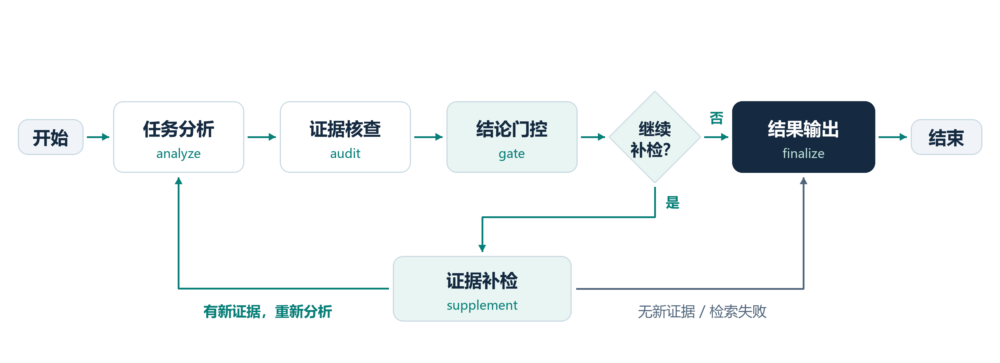

# 基于证据核查与自适应检索的科研软件 Good First Issue 理解与推荐方法

面向科研软件开源贡献新手，结合 Good First Issue（GFI）的任务描述与固定版本源码，分析任务目标、技术要求、实现入口和验证方式，并推荐技术需求相关的同项目任务。

本项目以**方法构建与实验研究**为核心，同时提供面向新手的可运行演示原型。研究对象覆盖 Manim、SymPy、Dask、Ray 和 napari 五个科研软件项目。

快速入口：[安装与启动](#5-安装与启动) · [实验与验证](#6-实验复现与验证) · [目录说明](#7-目录说明) · [贡献指南](CONTRIBUTING.md) · [文档导航](docs/README.md)

## 1. 要解决的问题

GFI是项目维护者为帮助新手参与而标记的入门任务，但“适合新手”不等于“容易看懂”。仅阅读标题和正文，新手仍可能不知道：

- 任务需要实现什么，在项目中起什么作用？
- 需要掌握哪些技术，相关实现和测试在哪里？
- 从哪里开始修改，怎样验证修改符合要求？
- 理解当前任务后，还有哪些技术需求相关的GFI可以继续探索？

本项目围绕这些问题，将任务解释与可追溯的源码证据连接起来，并研究证据核查、结论门控和缺口补检对分析质量的影响。

## 2. 方法与Agent工作流

输入为Issue标题、正文及固定版本代码仓库。系统检索代码、测试和文档，形成带有文件路径、行号和引用标识的证据包，再完成分析与核查。实验不使用Issue评论。

当前研究工作流采用 **LangGraph StateGraph** 编排，通过 **LangChain ChatDeepSeek** 调用 **DeepSeek Flash**。工作流包含五个节点：

| 节点 | 作用 |
| --- | --- |
| 任务分析 `analyze` | 根据Issue与当前证据，生成任务目标、技术要求、入手和验收建议 |
| 证据核查 `audit` | 检查结论是否得到引用证据支持，识别证据缺口 |
| 结论门控 `gate` | 根据核查结果处理结论，区分可支持内容、推断和不足 |
| 证据补检 `supplement` | 针对缺口检索新材料，更新证据包后返回分析节点 |
| 结果输出 `finalize` | 保存结果、执行轨迹与停止原因 |

补检最多两轮；达到轮次或资源上限、没有新增证据等情况下停止。输出区分材料明确要求、依据证据推断及建议验证项，不把证据不足的判断直接表述为事实。



### GFI推荐

演示原型根据已保存分析归一化任务技术标签，在同项目内使用**加权Jaccard相似度**筛选相关任务，展示共同技术、新增技术和推荐理由。推荐表示任务之间的技术相关性，不代表个人完成概率，也不是经过验证的难度进阶路径。

工作流实现见 [pipeline.py](gfi_prototype/research/pipeline.py)，详细说明见 [LangGraph工作流文档](docs/LANGGRAPH_WORKFLOW.md)。

## 3. 数据与实验规模

| 层次 | 数量 | 含义 |
| --- | ---: | --- |
| 项目 | 5个 | Manim、SymPy、Dask、Ray、napari |
| 采集记录 | 967条 | 原始Issue记录 |
| 清洗后具体任务 | 945条 | 演示时统一按开放、尚待解决处理 |
| 指引与汇总记录 | 22条 | 与具体任务分开组织 |
| 中文任务说明 | 967条 | 面向新手的中文展示资料 |
| 源码级任务分析 | 50条 | 门户使用的已保存分析档案 |
| 冻结实验任务 | 45题 | 排除6题开发样例后，形成39题留出集 |
| A/B/C/D消融实验 | 39题、156份答案 | 同一任务在四种条件下进行分析 |
| R/S/D控制实验 | 34题、102份答案 | 原计划39题，34题完成三组分析和评分，5题未完成 |

**156和102是答案份数，不是独立Issue数量。** 控制实验使用既有任务，不能与39题消融实验直接相加，声称有73个独立测试任务。门户50条分析也不等于实验集的标准答案。

### 实验一：A/B/C/D模块消融

| 组别 | 处理方式 |
| --- | --- |
| A | 仅根据Issue分析 |
| B | Issue加一次固定检索证据后分析 |
| C | 在B基础上加入证据核查与结论门控 |
| D | 在C基础上，针对证据缺口补检，再分析和核查 |

39题的已有答案采用DeepSeek Pro模型辅助评审，按0—4级评分。主答案指标与原始配套指导分开报告：

| 组别 | 正确性 | 完整性 | 主答案可操作性 | 不确定性表达 |
| --- | ---: | ---: | ---: | ---: |
| A | 3.41 | 2.54 | 2.23 | 3.49 |
| B | 3.46 | 3.03 | 2.62 | 3.62 |
| C | 3.18 | 2.62 | 2.44 | 3.13 |
| D | **3.56** | **3.13** | **2.92** | **3.62** |

D相对B的可操作性配对均差为 **+0.31分**，39题中18胜、15平、6负。D的前三项均分最高，不确定性表达与B持平；C低于B，提示单独加入核查可能过于保守，需要结合补检。收益存在项目与任务差异，不能理解为每题都会改善。

这156份答案来自迁移前的Python编排版本 `evidence_adaptive_v2`，**不是当前LangGraph版本重跑的结果**。

### 实验二：R/S/D调用匹配对照

为区分“补检策略的作用”与“增加模型调用的作用”，三组共享同一首轮结果，并匹配分析和核查轮数：

| 方法 | 后续处理 | 主答案可操作性 |
| --- | --- | ---: |
| R | 固定证据，反复修订与核查 | 2.44 |
| S | 按Issue固定查询排名扩展证据，再分析与核查 | 2.56 |
| D | 根据当前证据缺口自适应补检，再分析与核查 | **2.68** |

34题完整样本中，D相对R的配对均差为 **+0.24分**，相对S为 **+0.12分**。结果为缺口驱动补检提供方向性支持，但相对固定查询的优势较小，且存在项目差异。

该对照匹配逻辑调用轮数，**不严格匹配Token消耗**。5题未完成，完整样本可能存在选择偏差。以上评分均来自模型裁判，不是人工金标准或真实准确率，不据此宣称统计显著或普遍优越。

完整结果、失败披露、逐题差值及案例分析见 [比赛结果材料索引](output/提交材料索引.md)。

## 4. 演示原型

原型使用HTML、CSS和JavaScript展示页面，Python提供本地HTTP API与SSE流式回答，支持：

- **项目与任务浏览**：项目卡片、任务列表与中文任务说明。
- **任务导读**：已有分析、技术要求、入手建议和相关代码链接。
- **相关GFI推荐**：同项目候选任务及共同技术、新增技术解释。
- **对话问答**：资料助手整理本地已有内容；接入DeepSeek后支持流式追问。
- **研究方法展示**：介绍方法设计及消融比较。

门户展示已有资料与分析档案；研究实验单独保存核查、补检及模型评审记录。**门户50份分析不应表述为D组实验结果已经全部接入。**

原始记录保留采集时状态，演示层统一将任务视为开放、尚待解决，不代表已经核实当前上游状态。

## 5. 安装与启动

推荐Python 3.11。以下命令在项目根目录的PowerShell执行：

```powershell
python -m venv .venv
.\.venv\Scripts\python.exe -m pip install -r requirements.txt
.\.venv\Scripts\python.exe serve.py
```

原有`serve.py`是兼容入口；也可使用包入口：

```powershell
.\.venv\Scripts\python.exe -m gfi_prototype
```

需要开发安装时，在已安装运行依赖的同一虚拟环境中执行：

```powershell
.\.venv\Scripts\python.exe -m pip install --no-deps -e .
.\.venv\Scripts\gfi-portal.exe
```

三种入口调用同一份启动实现：

| 使用方式 | 入口 |
| --- | --- |
| 原有命令或PyCharm直接运行 | `serve.py` |
| Python模块启动 | `python -m gfi_prototype` |
| 编辑安装后的命令 | `gfi-portal` |

源码默认定位仓库根目录，不依赖终端工作目录。可以用`--root`指定数据工作目录；安装包包含网页资源，数据需要另附，见[数据与复现](docs/DATA_AND_REPRODUCIBILITY.md)。

浏览器打开 <http://127.0.0.1:8503/>。端口被占用时：

```powershell
.\.venv\Scripts\python.exe serve.py --port 8504
```

PyCharm中选择项目虚拟环境，直接运行 `serve.py` 即可。停止服务按 `Ctrl+C`。

**数据需要随项目提供。** `data/` 被Git忽略，单独下载源码不包含演示数据；查看研究结果还需要对应的 `experiments/` 和 `output/` 材料。

离线浏览与资料助手不需要API Key。使用模型问答时，参考 `.env.example` 在根目录 `.env` 中配置自己的 `DEEPSEEK_API_KEY`，启动时自动读取。不要将 `.env` 或真实密钥放入公开提交包。

详细说明见 [安装与运行指南](RUN_GUIDE.md)。

## 6. 实验复现与验证

### 查看已有结果

无需调用模型，可直接阅读 `output/` 中的Markdown报告和JSON汇总；冻结协议、逐题答案、评分与请求缓存保存在 `experiments/`。

离线重新汇总已有实验结果：

```powershell
.\.venv\Scripts\python.exe analyze_existing_experiments.py
```

该命令读取已有结果并重新生成39题分析报告，不产生模型请求。

34题汇总脚本为 `analyze_equal_budget_results.py`，同样不调用模型，但其追溯清单仍绑定历史文件 `output/演示PPT_13页叙述优化版.pptx`。当前提交目录没有该文件，直接重跑会报缺失；应先恢复对应原始文件，或另行调整并记录追溯配置。查看现成报告不受影响，不要将重命名后的最终PPT冒充原历史文件。

### 运行新的分析与评审

```powershell
.\.venv\Scripts\python.exe run_final_experiment.py
```

该入口使用当前LangGraph版本，默认写入 `experiments/frozen_20261017/langgraph_heldout_v1/`，会产生DeepSeek API费用。支持 `--phase analyze`、`--phase review` 和 `--output`，中断后可复用身份匹配的已完成缓存。历史39题消融结果保存在 `final_heldout_v3/`，不能用新框架名称替代其执行版本。

控制实验入口为 `run_equal_budget_experiment.py`，旧版完整样本评审入口为 `review_equal_budget_completed.py`；对应原始材料位于 `experiments/frozen_20261017/equal_calls_v1/`。重跑前应核对冻结协议、版本与输出目录，不要直接覆盖已提交结果。

### 离线代码检查

仅有源码、未下载数据包时，可以运行与GitHub Actions一致的离线检查：

```powershell
.\.venv\Scripts\python.exe -m unittest tests.test_package_metadata tests.test_cli tests.test_script_launcher tests.test_artifacts tests.test_storage tests.test_origins tests.test_settings tests.test_research_pipeline
node tests/test_portal_frontend.mjs
```

本地已准备完整数据包时，再运行全量Python回归：

```powershell
.\.venv\Scripts\python.exe -m unittest discover -s tests
```

前端检查需要Node.js。这些检查不调用真实模型，覆盖包入口、资源定位、检索、产物身份、研究流程、接口和流式回答等行为；代码测试通过不等于方法效果得到验证。

### 分组命令入口

`scripts/run.py`集中提供采集、清洗、分析和实验命令，底层执行原位脚本，不复制研究实现：

```powershell
.\.venv\Scripts\python.exe scripts/run.py --help
.\.venv\Scripts\python.exe scripts/run.py analyze -- --help
.\.venv\Scripts\python.exe scripts/run.py research -- --help
```

启动器将仓库根目录作为工作目录，相对输入和输出路径也以此为准。查看帮助不调用模型；实际运行继承原脚本的网络与付费行为，见[命令分类](scripts/README.md)。

## 7. 目录说明

```text
项目根目录/
├── pyproject.toml              # Python包元数据、依赖和命令入口
├── MANIFEST.in                 # 源码分发清单与排除规则
├── .github/                    # 自动检查与Issue/PR模板
├── serve.py                    # 兼容启动入口
├── scripts/                    # 按用途组织的命令启动器
├── web/                        # HTML、CSS、JavaScript界面
├── gfi_prototype/
│   ├── cli.py                  # 包启动入口，支持--root
│   ├── __main__.py             # python -m gfi_prototype
│   ├── portal.py               # 项目、任务和推荐数据适配
│   ├── artifacts.py            # 已保存分析及演示产物读取
│   ├── storage.py              # 产品文件读取
│   ├── chat.py                 # 资料助手与模型对话
│   ├── portal_server.py        # HTTP API与SSE传输
│   └── research/               # 实验协议、Agent流程、评估与缓存
├── data/                       # 原始数据、源码快照、索引和导读
├── experiments/                # 冻结实验、逐题答案和评分
├── output/                     # 最终分析报告、结果汇总和PNG流程图
├── tests/                      # 自动化验证
├── docs/
│   ├── README.md               # 文档导航
│   ├── data_collection/        # 采集记录
│   └── design/                 # 原始需求等设计资料
├── CONTRIBUTING.md             # 贡献与离线验证说明
├── SECURITY.md                 # 凭据及本地服务说明
├── requirements.in             # 直接运行依赖
├── requirements.txt            # 固定版本运行依赖
└── RUN_GUIDE.md                 # 环境安装与启动说明
```

根目录同时保留采集、清洗、分析、评审和报告脚本。部分路径与源码哈希参与冻结实验身份，不随目录整理任意移动。模块职责见 [当前代码结构](docs/CODE_STRUCTURE.md)，本次结构调整及验证结果见 [仓库重构记录](docs/REPOSITORY_REFACTOR.md)。

仓库贡献说明见 [CONTRIBUTING.md](CONTRIBUTING.md)，完整文档见 [文档导航](docs/README.md)，命令分类见 [scripts/README.md](scripts/README.md)。`.env`、虚拟环境、数据与付费缓存不进入公开源码包；本项目源码许可证尚未选定，上游材料遵循各自许可。
