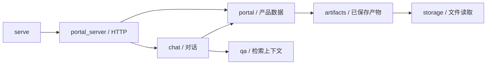

# 当前代码结构

维护重构日期：2026-10-19。前端页面及公开API行为保持不变。

| 位置 | 职责 |
| --- | --- |
| `serve.py` | 原有兼容启动入口 |
| `gfi_prototype/cli.py`、`__main__.py` | 包CLI、模块启动与资源定位 |
| `pyproject.toml` | 包元数据、依赖和gfi-portal命令 |
| `.github/` | 不依赖本地数据的自动检查及协作模板 |
| `scripts/` | 分组CLI启动器，调用原位研究脚本 |
| `web/` | HTML、CSS、JavaScript门户 |
| `gfi_prototype/portal.py` | 项目列表、Issue详情、推荐的产品数据适配 |
| `gfi_prototype/artifacts.py` | 读取最新完整演示批次、核对分析与证据的任务身份 |
| `gfi_prototype/storage.py` | 产品JSON与JSONL文件读取 |
| `gfi_prototype/chat.py` | 资料助手、DeepSeek流式回答及上下文构建 |
| `gfi_prototype/portal_server.py` | HTTP路由、安全校验、SSE传输 |
| `gfi_prototype/research/` | 实验协议、工作流、缓存、预算和模型调用 |
| 根目录 `run_*.py`、`judge_experiments.py` | 研究运行及评审入口；路径与源码哈希影响冻结实验身份，保留原位 |
| 其他采集/分析CLI | 数据采集、索引、导读生成和产物导出，按需单独运行 |
| `tests/` | 产品、检索、研究流程及边界测试 |
| `data/` | 原始数据、源码快照、产品导读与匹配产物 |
| `experiments/` | 冻结协议、答案、模型评审及付费请求缓存 |
| `output/` | 研究报告、PPT和审计结果 |
| `docs/archive/` | 保留的历史参考资料 |

## 调用关系

研究模块与产品模块分开维护。`common.py` 等历史研究依赖仍保留原实现，避免无意改变缓存身份。`unified.py` 仍被分析缓存和研究推荐使用，因此保留。

## 已退役

旧Streamlit入口 `app.py`、`app_v2.py` 及专用UI、样式和测试已回收。旧 `summarize_issues.py` 摘要链已回收；当前中文说明由 `newcomer_content.py` 对应的产物提供。有效的分析产物测试已迁移至 `test_artifacts.py`，来源标记测试迁移至 `test_origins.py`。

历史文档可能描述当时的代码和结果；当前启动方式以根目录 `RUN_GUIDE.md` 为准。安装清单只有 `requirements.in`（直接依赖）和 `requirements.txt`（固定依赖闭包）。

历史output清理记录见 `docs/OUTPUT_CLEANUP.md`。当前结构重构的本地验证材料位于 `docs/maintenance/`；数据、实验及PPT不在此次清理范围。

## 开源仓库布局更新

保留flat package布局，源码仍在gfi_prototype，研究脚本因冻结身份保留原位。采集记录归入docs/data_collection，原始需求归入docs/design。源码/wheel与数据的分发边界见[数据与复现](DATA_AND_REPRODUCIBILITY.md)。维护审计记录保存在本地docs/maintenance，不再假设output中保留开发审计目录。
