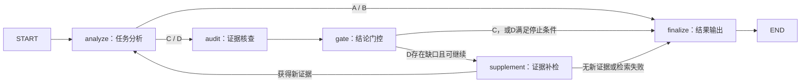

# LangGraph＋LangChain研究工作流

## 实现与范围

研究流程现由 `LangGraph StateGraph` 编排；`LangChain ChatDeepSeek` 调用DeepSeek模型。模型、提示词、证据检索规则、选择性门控、补检上限与原方法一致。前端没有改动，研究输出仍不会自动写入门户缓存。

- 工作流：`gfi_prototype/research/pipeline.py`。
- 模型客户端与预算：`gfi_prototype/research/client.py`。
- 证据核查、门控：`gfi_prototype/research/evidence.py`。
- 补检：`gfi_prototype/research/retrieval.py`。
- 新执行版本：`evidence_adaptive_langgraph_v1`。

## 节点与条件边



分析、核查或门控失败也会进入finalize。每轮只有在该条件要求的节点全部成功后才保存为完整轮：A/B要求分析成功；C/D要求分析、核查与门控成功。后续轮失败时返回上一完整轮，不将未经核查的新分析冒充最终门控结果。

| 节点 | 输入 | 输出和职责 |
| --- | --- | --- |
| analyze | 当前证据包 | DeepSeek生成TaskAnalysisV2；沿用Pydantic及证据ID、文件路径校验 |
| audit | 分析结论及其引用材料 | DeepSeek判断直接支持、合理推断、部分支持或依据不足；给出缺口和检索词 |
| gate | 原分析和核查结果 | 程序门控任务目标、技术要求、能力门槛与验收项；入手步骤和文件列表仍属未全部语义门控的原始配套内容 |
| supplement | 当前包和缺口检索词 | 本地查询最多4条，每轮最多新增4片；去重、更新证据包后重新分析 |
| finalize | 最后完整轮及错误/资源记录 | 保留原结果字段，新增workflow.engine和实际node_trace |

分析和核查默认都是 `deepseek-flash` 的不同提示词角色，不是两个不同模型。外部实验评分仍由 `judge_experiments.py` 的DeepSeek Pro完成，不是内部workflow节点。

## 状态、资源与停止

`WorkflowState`使用TypedDict保存证据包、当前分析、核查、完整轮列表、查询、错误、轮次和流向。客户端、API密钥与检索器保存在节点闭包，不进入图状态。未启用云端追踪和图checkpoint；已有JSON结果缓存提供任务级续跑，不支持中断后直接恢复到任意图节点。

补检最多2轮，即最多3次完整分析。当前结论全部获支持、缺少检索词、没有新证据、达到轮次上限、预算耗尽或执行错误时停止。“当前结论全部获支持”不等于原Issue全部问题已解决，也不表示执行过测试。

`ResearchSession`继续统计真实API调用、用量、耗时、失败和校验重试；SDK自动重试关闭，避免绕过预算。用量缺失时停止后续调用，不把未知用量当零。节点开始时及等待模型期间会打印进度。

## 查看真实图：不调用API

在PyCharm中直接运行根目录的 `export_workflow.py`，或执行：

```powershell
.\.venv\Scripts\python.exe export_workflow.py
```

生成 `output/langgraph_workflow.mmd` 和 `output/langgraph_workflow.md`。这是从编译后的实际图导出，不执行模型节点，不消耗API Token。

## 执行新实验：会调用DeepSeek

项目虚拟环境已安装依赖；其他环境先执行：

```powershell
.\.venv\Scripts\python.exe -m pip install -r requirements.txt
```

先用一个开发任务运行D组，观察节点进度：

```powershell
.\.venv\Scripts\python.exe research.py --output experiments/frozen_20261017/langgraph_dev_v1 run --variants D --task-id "ManimCommunity/manim#2379"
```

若准备重新运行正式39题四组实验，在PyCharm直接运行 `run_final_experiment.py`，或：

```powershell
.\.venv\Scripts\python.exe run_final_experiment.py
```

新结果和评审独立存入 `experiments/frozen_20261017/langgraph_heldout_v1/`。只分析用 `--phase analyze`，只评审或续评用 `--phase review`；有自定义输出时续跑必须保留相同的 `--output`。

继续旧156份答案的评审：

```powershell
.\.venv\Scripts\python.exe run_final_experiment.py --phase review --output experiments/frozen_20261017/final_heldout_v3
```

Runner在任何模型会话开始前检查所有待写入结果的cache_key；旧版本、模型或协议不同就拒绝覆盖，要求新输出目录。已保存的旧结果仍可读取和评审。不要把新旧版本答案合并成同一次实验。

## 验证与结论边界

迁移采用离线脚本模型、LangChain Runnable和HTTP Mock验证节点执行、引用/结构约束、补检、预算、失败恢复与SDK请求格式，没有重跑真实模型实验。历史 `final_heldout_v3` 的156份答案与评分来自 `evidence_adaptive_v2`，不能称作新框架实验结果；换框架本身不证明效果提升。

另从旧156份答案中选取155份无执行错误的缓存记录回放模型响应，对比分析、核查、门控、证据包、逐轮记录、停止原因与状态均一致；1份历史执行错误案例不纳入该回放，其失败行为由专门离线测试覆盖。回放前后156个历史答案文件哈希不变。这验证编排兼容性，不是再次进行模型效果实验。

离线验证：

```powershell
.\.venv\Scripts\python.exe -m unittest discover -s tests -p "test_research*.py" -q
.\.venv\Scripts\python.exe -m unittest tests.test_final_experiment_output -q
.\.venv\Scripts\python.exe -m pip check
```

API依据：[LangGraph Graph API](https://docs.langchain.com/oss/python/langgraph/graph-api)、[ChatDeepSeek](https://docs.langchain.com/oss/python/integrations/chat/deepseek)。
