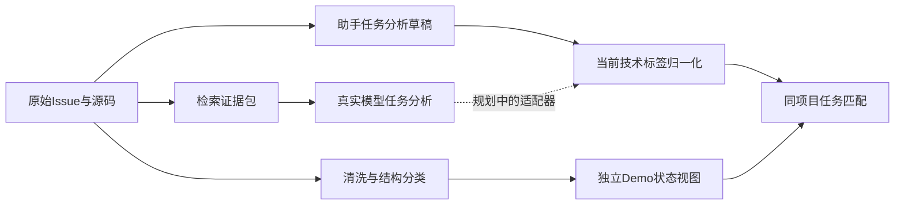
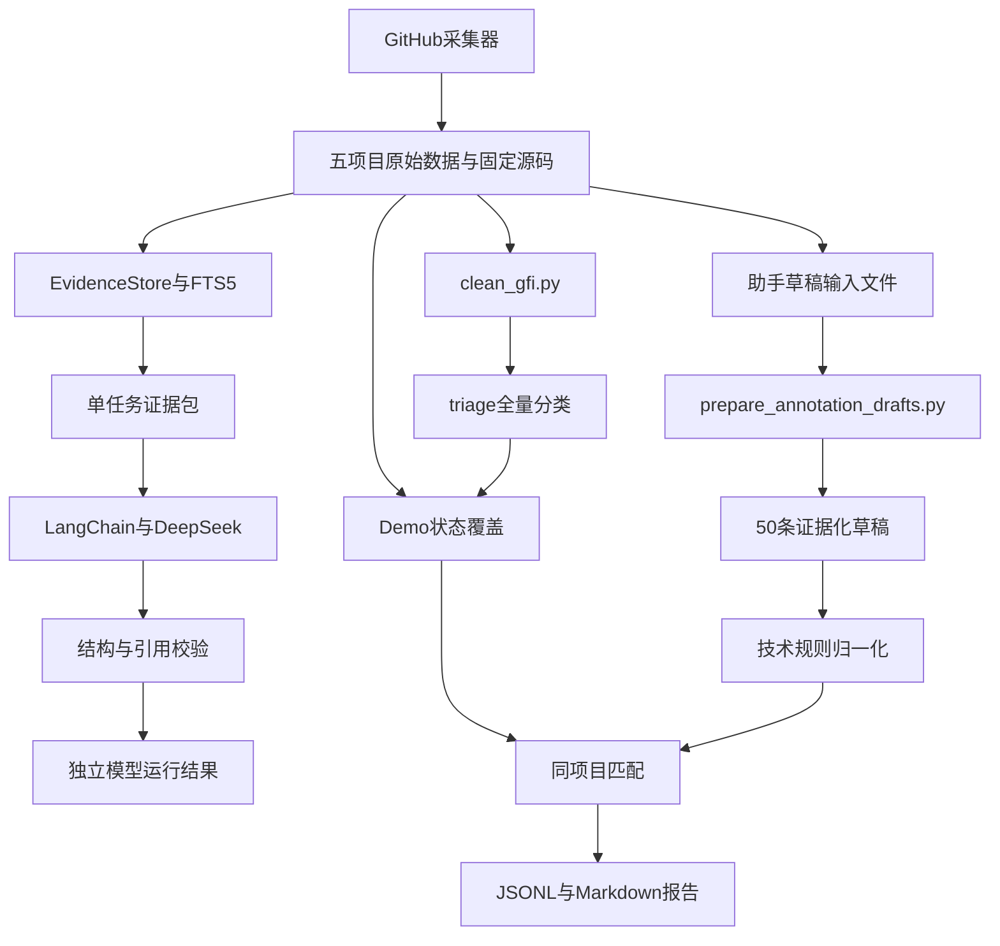
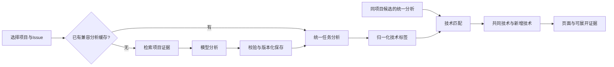

# 项目与 Good First Issue 分析智能体技术文档

> **2026-10-18更新：** 研究管线已采用LangGraph＋LangChain，具备受控证据补检回路。当前节点与运行方式见 [LangGraph工作流](LANGGRAPH_WORKFLOW.md)；下文“LangGraph未安装”“尚无补检”等描述属于早期版本记录，不代表当前研究实现。历史156份实验答案未改写为新框架结果。

> 本文保留早期技术设计和历史状态。2026-10-16最新交付已改为HTML新人门户，完成967条DeepSeek中文说明、50条DeepSeek源码级v2分析及对应技术推荐；最新运行方式与覆盖见[新人门户说明](NEWCOMER_PORTAL.md)。下文旧“待实现”与调用覆盖不代表当前状态。

> 文档版本：1.1（Ray扩展）；编制日期：2026-10-16（北京时间）。
>
> 对应工作区：`D:\haikesong-------bisai`。本文依据当前第一方代码、数据审计和实际运行清单编写，区分“已实现”“已有草稿”和“规划”。文中示例配置不包含真实凭据。

## 阅读导航

| 章节 | 解决的问题 |
| --- | --- |
| 1—3 | 项目做什么、Demo假设是什么、当前完成到哪里 |
| 4—6 | 第一步输入哪些数据、现有数据有多少、各层数据如何使用 |
| 7—9 | 技术选型、总体架构、代码模块与执行链路 |
| 10—13 | 采集、清洗、证据检索和LangChain模型分析的实现 |
| 14—16 | 技术标签、同项目任务匹配和输出文件契约 |
| 17—19 | 当前接口、目标新版本与界面设计 |
| 20—23 | 安装运行、配置、复现与故障处理 |
| 24—27 | 测试、效果评估、局限、后续实施与演示交付 |
| 附录 | 术语、常用命令、资料索引与协作约定 |

---

## 1. 项目概述

### 1.1 项目定位

本项目面向希望参与开源项目的新手，围绕一个具体的 Good First Issue（下文简称GFI）生成可追溯的技术分析，并根据任务需要的技术，匹配同一项目中的其他GFI。

用户输入仓库与Issue A，系统的目标输出包括：

1. A要解决的问题和预期修改范围。
2. A涉及的语言、库、框架、工具与知识概念。
3. 适合开始A的开发背景，以及需要具备的前置知识。
4. 建议的新手阶段、进入条件和开始步骤。
5. 与A技术需求相关的同项目Issue B，以及共同技术、新增技术和依据。

本项目描述的是“任务需要什么能力、适合什么背景”，不建立具体个人的能力画像，不收集个人履历，也不计算个人完成任务的成功率。

### 1.2 需要解决的问题

GFI标签本身只提供有限的入门信号，无法完整回答以下问题：

- 任务描述提到的旧文件或接口，在当前项目中对应哪里？
- 项目虽然依赖多个框架，但完成这个具体任务究竟需要哪些？
- 开始任务之前应先阅读哪些代码和测试？
- 具备什么基础的人可以尝试，哪些知识还需要补充？
- 研究过当前任务后，同项目哪些任务能够复用类似知识？

系统通过Issue、项目代码、测试和文档的联合分析提供这些信息。后续任务建议采用可解释的技术标签相似度，而不是根据个人资料进行匹配。

### 1.3 产品输出形式

当前交付形式为命令行程序、JSON/JSONL数据和Markdown报告。目标展示形式为Streamlit交互页面。

在产品展示中，应将“任务分析”和“后续候选”放在相邻区域，让用户能够从A的技术要求直接理解为什么出现B。

## 2. 范围、Demo假设与边界

### 2.1 当前采用的Demo假设

按用户明确设定，全部已采集GFI在Demo中统一按照开放、未解决处理：

```json
{
  "demo_assumption": true,
  "effective_state": "open",
  "effective_resolution": "unresolved",
  "status_used_for_filtering": false,
  "current_availability_verified": false
}
```

关闭、指派、评论认领和关联PR状态均不参与匹配过滤。本轮Demo不需要联网刷新这些状态，也不以补采PR或review作为前置条件。

上述约定是演示中的状态覆盖，不是对GitHub现实状态的断言。原始记录仍保留`state_at_snapshot`等采集事实，便于复现。

### 2.2 推荐规则边界

技术匹配仅在以下候选中进行：

- 与A属于同一仓库。
- 与A编号不同。
- 清洗后属于具体任务，`record_type=task`。
- 已有可比较的技术分析。
- 技术标签与A存在交集。

指引帖、汇总帖虽然也有演示状态，但不当作一个具体修改任务推荐。任务关闭与否不影响上述筛选。

### 2.3 本轮不包含的功能

- 具体用户的技能问卷、能力评分、画像或个性化匹配。
- 自动修改源代码、提交PR、执行目标仓库代码。
- 实时检查任务是否可认领。
- 证明完成A之后一定具备完成B的能力。
- 给出精确完成时长、成功概率或已验证的长期留存收益。

这些边界使Demo能够集中展示任务理解和技术衔接，不增加与当前目标无关的模块。

## 3. 当前实现状态

### 3.1 功能状态表

| 能力 | 状态 | 当前证据或限制 |
| --- | --- | --- |
| 五项目Issue、评论、timeline与源码采集 | 已实现 | 967条原始记录，五项目独立目录 |
| 原始数据身份、分页与完整性处理 | 已实现 | 采集manifest、断点复用及测试 |
| Dask/Manim GFI标签复查 | 已实现 | 两仓库376条记录的标签检查产物 |
| 具体任务、历史任务与指引分类 | 已实现 | 清洗schema版本3，945个具体任务 |
| 50条证据化任务分析草稿 | 已有草稿 | 助手编写，各仓库10条，待独立人工复核 |
| 固定源码全文检索 | 已实现 | SQLite FTS5，已为Manim建立真实索引 |
| LangChain调用DeepSeek分析单任务 | 已实现 | Manim #4983真实调用1次 |
| 模型JSON、引用与源码片段核验 | 已实现 | 不等价于语义正确性验证 |
| 技术标签归一化 | 已实现 | 38条规则，输入为已有草稿的技能名称与理由 |
| 同项目A→B技术匹配 | 已实现 | 50个起点，精确候选数量见当前Demo运行清单 |
| Demo统一开放、未解决状态 | 已实现 | 967条独立演示记录，原始状态不改写 |
| 模型新版技术栈、背景、阶段与开始步骤 | 已实现 | `gfi_prototype/analysis_v2.py` schema v2，四阶段中文枚举，输出语义仍待人工复核 |
| 模型结果自动接入任务匹配 | 已实现 | `gfi_prototype/unified.py` 适配器+`analysis_cache.py`，Demo与报告标注真实模型/草稿来源 |
| 批量真实分析与版本化缓存 | 已实现 | `batch_analyze.py`+`batch_tasks.json`；分析/技术标签/匹配三级缓存键见18.5 |
| 精确符号优先检索及自主补查 | 规划 | 当前主要是FTS5检索与固定证据包 |
| HTML交互界面 | 已实现 | `serve.py` 启动，`web/` 展示项目、任务说明、推荐及问答 |
| 任务分析/推荐效果评估 | 规划 | 已有工程测试，不等价于有效性实验 |

### 3.2 三种产物必须区分

| 产物 | 来源 | 数量口径 | 可以用于什么 |
| --- | --- | --- | --- |
| 助手任务分析草稿 | 阅读Issue和源码后编写 | 50条 | 开发、试标、当前技术标签归一化 |
| 真实模型分析 | LangChain调用DeepSeek | 1次成功运行 | 验证单任务分析链路、检查模型输出 |
| Demo技术匹配 | 草稿技能经过规则归一化和计算 | 50个起点的候选集合，数量见manifest | 演示技术相似度及双侧证据 |

任务匹配数量不等于模型调用次数；50条草稿不是50条真实模型推理结果；当前没有独立人工确认的标准答案。

### 3.3 当前“智能体”的准确含义

项目目标是构建GFI分析智能体；当前模型部分实际使用受控的LangChain固定流水线：程序检索证据、模型生成分析、程序校验输出。模型尚未自主选择工具或循环补查。

技术匹配部分是确定性的Python算法，不额外调用模型。后续接入只读检索工具或有限循环时，应继续保留调用预算、证据追踪和明确结束条件。

## 4. 第一步的输入数据清单

### 4.1 用户提供的运行输入

| 输入 | 示例 | 必需性 | 作用 |
| --- | --- | --- | --- |
| 仓库标识 | `ManimCommunity/manim` | 必需 | 确定项目数据目录与同项目候选池 |
| 当前Issue编号 | `4983` | 必需 | 确定要分析或作为匹配起点的任务A |
| 推荐数量 | `3` | 可选，默认3 | 最多返回多少个B候选，当前允许1—10 |
| 运行模式 | `retrieve`或`analyze` | 仅模型分析入口需要 | 区分只检索与真实模型调用 |
| 本地项目根目录 | 当前工作区 | 可选 | 定位已经采集的数据 |

产品界面可以让用户选择仓库和任务，当前命令行暂不自动把任意GitHub链接解析为上述参数。模型入口只允许代码中列出的五个仓库；匹配入口通过本地已有分析查找任务。

### 4.2 任务分析需要的原始数据

| 数据类别 | 最小字段或内容 | 重要程度 | 当前存放位置 | 用途 |
| --- | --- | --- | --- | --- |
| 项目身份 | owner/repo、仓库URL | 必需 | `repository.json`及各记录`repo` | 避免跨项目混用 |
| GFI身份 | 编号、URL、标签 | 必需 | `issues/<number>.json` | 唯一定位任务，追踪来源 |
| Issue正文 | 标题、body | 必需 | 原始Issue对象 | 问题、目标、复现和技术线索 |
| 评论 | 正文、URL、时间、关联角色等 | 有则使用 | bundle的`comments` | 讨论补充、限制条件、接口意见 |
| 源码 | 固定commit完整工作树 | 证据分析需要 | 源码ZIP和`source/` | 定位真实实现及调用关系 |
| 源码版本收据 | commit、归档名、SHA256 | 必需 | `source_snapshot.json` | 固定引用位置与完整性核验 |
| 相关测试 | 测试实现与断言 | 优先使用 | 源码中的测试目录 | 理解边界和验证方式 |
| 项目介绍 | README、项目文档 | 推荐使用 | 源码归档 | 理解用途、术语与模块 |
| 开发说明 | CONTRIBUTING等 | 推荐使用 | 源码归档 | 环境和参与步骤 |
| 依赖与构建配置 | pyproject、setup、requirements等 | 推荐使用 | 源码归档 | 识别工具链及任务相关依赖 |
| CI配置 | workflow、测试运行配置 | 按任务使用 | 源码归档 | 理解项目的验证入口 |
| 时间戳 | 采集时间、Issue更新时间 | 必需保留 | bundle及清洗记录 | 说明数据版本与观察时间 |

项目的依赖清单只能表明项目使用某技术；要判断某个GFI必须使用该技术，还需关联任务证据，不能把项目全部依赖直接复制为每项任务的技术要求。

### 4.3 A→B匹配额外需要的输入

| 输入 | 为什么需要 | 当前来源 |
| --- | --- | --- |
| A的任务技术要求 | 构建起点标签集合 | A的`required_skills_draft` |
| 同项目候选任务的技术要求 | 计算B与A的重合 | 其余任务的`required_skills_draft` |
| 标签归一化规则 | 统一不同表述 | `technology_rules.json` |
| 具体任务分类 | 排除汇总和指引 | `processed/triage.jsonl` |
| 双侧原始证据 | 解释共同技术从何而来 | 每条草稿的`evidence` |

技术要求和标签属于处理后的数据。首次构建系统时，输入原始Issue和源码；先生成任务分析，再执行标签归一化及匹配。

### 4.4 当前不需要新增的数据

当前Demo不需要个人GitHub历史、个人技能测评、全量贡献者资料、完整Git历史、实时认领状态或解决PR的完整review。现有项目文档和测试已经在源码快照中，无需为了获得这些材料重新下载整仓库。

## 5. 现有数据规模与采集口径

### 5.1 项目分布

以下开放/关闭均为原始采集事实，不是Demo筛选条件。

| 项目 | 原始记录 | 开放 | 关闭 | 开放具体任务 | 关闭具体任务 | 指引/汇总 | 分析草稿 |
| --- | ---: | ---: | ---: | ---: | ---: | ---: | ---: |
| SymPy | 53 | 53 | 0 | 49 | 0 | 4 | 10 |
| napari | 18 | 18 | 0 | 15 | 0 | 3 | 10 |
| Dask | 223 | 21 | 202 | 18 | 202 | 3 | 10 |
| Manim | 153 | 18 | 135 | 15 | 135 | 3 | 10 |
| Ray | 520 | 69 | 451 | 62 | 449 | 9 | 10 |
| 合计 | 967 | 179 | 788 | 159 | 786 | 22 | 50 |

22条非具体任务包含20条汇总/跟踪帖、2条入门指引。具体任务总数为`159 + 786 = 945`。

### 5.2 讨论数据分布

| 项目 | 评论数 | timeline事件数 | 当前提取的关联PR摘要 |
| --- | ---: | ---: | ---: |
| SymPy | 834 | 1773 | 0 |
| napari | 130 | 386 | 0 |
| Dask | 1189 | 3238 | 0 |
| Manim | 644 | 1943 | 0 |
| 合计 | 2797 | 7340 | 0 |

评论文本可能也出现在timeline的`commented`事件中，两个数量不是互不重叠的独立自然语言样本。构建模型上下文时，应避免把同一评论重复加入。

关联PR摘要为0只表示当前摘要提取结果为空，不能推出这些任务没有PR。现有清洗器还会从文本中发现PR链接线索，这些线索与原始bundle中的PR摘要不是同一个字段。Demo不依赖这两类信息进行过滤。

### 5.3 标签与采集范围

| 项目 | 采集入口 | 标签 | 原始采集状态范围 |
| --- | --- | --- | --- |
| SymPy | `collect_gfi.py` | `Easy to Fix`和`good first issue`取并集 | open |
| napari | `collect_gfi.py` | `contribute:good first issue` | open |
| Dask | `collect_dask_manim.py` | 实际解析为`good first issue` | all |
| Manim | `collect_dask_manim.py` | 实际解析为`good first issue` | all |
| Ray | `collect_ray.py` | 实际解析为`good-first-issue` | all |

因此，这是一组“GFI及相近入门标签”的数据，不能把五项目都描述为使用完全相同标签。

采集只能发现查询当时仍保留目标标签的Issue；曾有标签但后来移除的历史任务不保证被包含。数据集是某个采集时间窗口的快照，不是GitHub全部历史GFI。

### 5.4 固定源码版本

| 项目 | 固定commit |
| --- | --- |
| SymPy | `9350380769d772f6fb320052214afc2d488a41a3` |
| napari | `18b66421df394eeba09d3da8678f8770beebf4e1` |
| Dask | `6ce3740fa79bfa051ecc74c3641f8c6a46dfdc30` |
| Manim | `622520d34190062f32d68af066c80f1c937fc8bf` |
| Ray | `3235a8e1e84de7c7fde217553c83e3c38d8560fe` |

这些是采集时固定的源码版本，不保证与每条旧Issue创建时间对齐。源码归档不包含全部Git历史、其他分支、额外拉取的LFS实体或子模块内容。

### 5.5 数据充分性

当前五项目及50条分析足以推进可交互Demo。最直接的扩展是分析更多现有任务，而不是立即增加仓库数量。

当前未进入技术匹配的具体任务数为`945 - 50 = 895`。这些任务没有被判定不适合，只是尚无匹配所需的技术描述。匹配清单不能被描述为从全部945个具体任务中进行了完整技术排序。

## 6. 数据分层与使用原则

### 6.1 数据处理层次



虚线表示尚未完成的模型输出适配。当前不是模型分析完成后自动生成标签和推荐的一条完整在线链路。

### 6.2 各层的用途与写入规则

| 层次 | 主要文件 | 使用方式 | 写入方式 |
| --- | --- | --- | --- |
| 原始层 | issues、repository、源码归档 | 事实来源与复现 | 采集器按明确范围生成 |
| 清洗层 | triage、tasks、historical_tasks | 分类、检索候选和开发检查 | 清洗器重新导出 |
| 草稿层 | annotations | 开发样本与人工复核 | 导出草稿，已有复核表不覆盖 |
| 检索层 | SQLite索引 | 加速源码片段定位 | 归档/索引版本变化时重建 |
| 模型运行层 | prototype_runs | 保存证据、输出与调用记录 | 每次创建独立运行目录 |
| Demo运行层 | demo_runs | 状态覆盖、标签和匹配结果 | 每次创建独立运行目录 |
| 审计层 | data_audit、各类报告 | 核对规模、材料与版本 | 审计脚本重新生成 |

### 6.3 三项核心使用原则

1. 事实、推断和演示假设分别记录。源码位置可核验，不代表任务结论已经正确。
2. 项目文本只作为分析材料。Issue、评论、源码中的自然语言不作为程序或模型的执行授权。
3. 不使用助手草稿作为模型分析时的标准答案输入。真实单任务原型只读取原始Issue、有限评论和源码证据。

### 6.4 原始状态与Demo状态的关系

清洗器仍按原始开放/关闭输出不同文件，这有助于理解数据来源。Demo入口读取全量`issues.jsonl`与全量`triage.jsonl`，而非只读取159条开放具体候选，因此不会因为清洗目录中的历史分组而排除关闭任务。

演示假设没有要求抹去代码中已有实现或评论中的技术信息；这些材料仍可帮助理解任务。状态假设只改变Demo的候选处理规则。

## 7. 技术选型与取舍

### 7.1 运行环境

| 技术 | 当前状态或版本 | 用途与选择理由 |
| --- | --- | --- |
| Python | 标准库流程要求3.10+，已验证3.11.8 | 采集、JSON处理、检索、规则、CLI使用同一语言 |
| JSON/JSONL | 已使用 | 保留嵌套证据结构，便于逐条检查与导出 |
| CSV | 已使用 | 供人工浏览和填写任务复核意见 |
| SQLite FTS5 | 已使用 | 本地全文检索，无独立检索服务部署 |
| `langchain-core` | `1.6.11` | 提示词模板和LCEL调用组合 |
| `langchain-deepseek` | `1.1.1` | DeepSeek模型接入 |
| Pydantic | `2.14.1` | 输出字段、枚举和嵌套结构校验 |
| DeepSeek | 当前配置`deepseek-flash` | 按用户指定模型进行分析 |
| `unittest` | Python标准库 | 当前116项工程测试 |
| Streamlit | 规划 | 以较少部署工作构建演示页面 |
| LangGraph | 可选规划，当前未安装使用 | 有自主补查和状态恢复需求时再引入 |

版本是当前工作区实测和安装锁定结果，不表示其永远是上游最新版本。安装依赖应优先使用项目的固定版本文件。

### 7.2 为什么采用LangChain

当前LangChain承担提示词、模型调用和输出校验之间的连接：

```text
ChatPromptTemplate → ChatDeepSeek → RunnableLambda(validate_analysis)
```

这能把输入证据、schema约束和校验结果放在同一调用流程中，同时保留以后加入只读检索工具的空间。DeepSeek接入使用独立集成包，参见[LangChain的ChatDeepSeek说明](https://docs.langchain.com/oss/python/integrations/chat/deepseek)。

项目已移除未使用的`langchain`元包和LangGraph相关包，但仍在使用`langchain-core`；这不会改变LCEL流水线的技术归属。`langchain-openai`等SDK包是现有集成的传递依赖，不表示程序另行调用其他模型服务。

### 7.3 为什么使用SQLite全文检索

当前源码检索线索主要来自文件名、符号名、错误消息和技术词。SQLite FTS5能够支持全文查询和BM25排序，适合本地可复现Demo，不必额外启动向量服务。其能力和查询语法参见[SQLite FTS5文档](https://www.sqlite.org/fts5.html)。

后续如果同义表达导致召回不足，可以先改进精确符号检索，再根据实验结果决定是否加入向量召回。不要将数据库数量作为系统完成度指标。

### 7.4 为什么采用结构化输出

模型输出必须能被后续标签和匹配程序读取，因此当前要求JSON对象，并在客户端执行Pydantic校验。Pydantic支持声明模型结构及约束，参见[模型定义文档](https://pydantic.dev/docs/validation/latest/concepts/models/)。

JSON模式只约束响应形式，客户端字段校验仍有必要。程序可以核对证据ID是否存在，但不能仅靠schema证明结论语义正确。

## 8. 总体架构

### 8.1 当前已实现架构



### 8.2 目标端到端架构（规划）



统一分析、模型适配器、缓存服务和页面属于后续工作，当前没有对应HTTP服务或完整在线入口。

### 8.3 模块依赖原则

模型只负责基于证据生成任务解释；状态覆盖、候选筛选、相似度排序、文件校验和运行记录由程序负责。改变推荐权重不应强制重新调用模型。

清洗层保留历史事实，Demo层按约定覆盖状态。任务匹配层不应读取或推断用户身份，也不应将个人贡献历史变成隐含输入。

## 9. 代码结构与模块职责

| 文件 | 核心职责 | 依赖范围 |
| --- | --- | --- |
| `collect_gfi.py` | SymPy/napari采集、共享GitHub客户端、源码处理、通用JSON函数 | 标准库 |
| `collect_dask_manim.py` | Dask/Manim标签解析、并行采集及标签审计 | 标准库与采集核心 |
| `collect_ray.py` | Ray全部状态采集与标签审计，启用内部缺失链接文本保留策略 | 复用同一采集/审计核心 |
| `clean_gfi.py` | 全量分类、状态信号保留、清洗报告 | 标准库与通用函数 |
| `triage_overrides.json` | 有证据的汇总/指引结构分类覆盖 | 数据配置 |
| `prepare_annotation_drafts.py` | 验证明确编写的草稿及源码锚点，导出50条材料 | 标准库 |
| `annotation_drafts.json` | 原SymPy/napari草稿定义 | 输入配置 |
| `annotation_drafts_additional.json` | Dask/Manim新增草稿定义 | 输入配置 |
| `annotation_drafts_ray.json` | Ray新增10条草稿，保留原四项目40条 | 输入配置 |
| `gfi_prototype/retrieval.py` | 源码归档检索、证据包和校验 | 标准库 |
| `gfi_prototype/analysis.py` | Pydantic schema、提示词、LCEL分析和修复重试 | 模型依赖 |
| `analyze_issue.py` | 单任务CLI、模型配置、输出报告和运行清单 | 检索、模型集成 |
| `gfi_prototype/task_matching.py` | Demo状态、技术归一化、相似度匹配 | 标准库 |
| `technology_rules.json` | 38条标签规则及权重 | 输入配置 |
| `recommend_gfi.py` | 全项目数据加载、匹配和Demo报告 | 标准库与任务匹配 |
| `audit_gfi_data.py` | 数据规模、源码哈希、项目资料和产物审计 | 标准库 |
| `requirements.in` | 模型原型直接依赖范围 | 安装配置 |
| `requirements.txt` | 当前44个运行依赖的固定版本 | 安装配置 |

`technology_profile`等函数中的profile表示“任务技术描述”，不表示个人画像。已删除的个人画像和用户匹配支线不应重新成为主流程依赖。

## 10. 数据采集实现

### 10.1 采集单元与原始bundle

一个任务保存为一个bundle，核心结构如下（仅展示必要字段）：

```json
{
  "schema_version": 1,
  "repo": "ManimCommunity/manim",
  "fetched_at": "2026-10-16T06:00:24+00:00",
  "complete": true,
  "issue": {
    "number": 4983,
    "title": "Issue标题",
    "body": "原始正文",
    "state": "open",
    "html_url": "https://github.com/ManimCommunity/manim/issues/4983",
    "labels": [{"name": "good first issue"}]
  },
  "comments": [],
  "timeline": [],
  "related_pull_requests": []
}
```

实际Issue对象还保留API返回的其他字段。`complete=true`表示该次bundle获取流程完成，不表示已经验证任务的真实可解决性。

### 10.2 分页、去重与并行

- GitHub分页使用每页100条，并跟随`Link`中的下一页地址。
- 同项目多标签查询按Issue编号去重，排除API中混入的PR对象。
- 两个项目以两个worker并行采集。
- 原SymPy/napari入口默认每项目1个Issue worker；Dask/Manim入口设置每项目4个Issue worker。
- 凭据按项目分配，重复Token会去重，共享对应的节流状态。
- 同一GitHub账号的不同Token仍可能共享额度，程序不假设Token数量等于可用额度倍数。

### 10.3 限流、异常和断点

GitHub客户端单请求最多尝试6次，结合`Retry-After`、剩余额度、重置时间及网络异常进行等待。默认API请求超时60秒，允许的最大单次限流等待由`--max-rate-wait`控制。

缓存仅在原Issue对象相同、bundle完整且字段结构符合预期时复用。`--refresh`用于重新获取评论与timeline。输出目录使用`.collector.lock`避免两个采集进程同时写入同一批项目数据。

`manifest.status=complete`只对应本次选定范围；`limited_run=true`表示有限联调，不能当全量采集。失败会记录阶段和Issue编号，并返回失败退出码。

### 10.4 源码归档与符号链接

采集器固定commit并保存源码ZIP、SHA256收据和解压后的工作树。源码不执行。

Windows环境下，仓库内安全符号链接可物化为普通文件或目录；指向仓库外及循环链接被拒绝。旧项目默认也拒绝缺失目标。Ray归档有一条内部缺失目标链接，Ray入口显式将其保留为原始链接文本，并由收据记录；不跟随或补造目标。检索索引排除链接别名及保留的链接文本。

当前源码ZIP用于校验式检索，解压树用于草稿锚点核对，两份材料各有用途。

## 11. 数据清洗与开发样本

### 11.1 清洗顺序

1. 读取每项目`issues.jsonl`。
2. 检查bundle完整性、仓库身份及是否混入PR。
3. 处理重复记录；同编号但内容冲突时停止。
4. 清理用于分析的Markdown文本，同时保留原文。
5. 区分具体任务、汇总/跟踪帖和入门指引。
6. 保留任务类型、原始状态、讨论信号和质量标记。
7. 导出全量分类、开放具体任务、历史任务和非任务记录。

### 11.2 关键清洗字段

| 字段 | 含义 | 在Demo中的使用 |
| --- | --- | --- |
| `record_type` | task/umbrella/guide | 只让具体任务参与匹配 |
| `task_types` | 文档、测试、缺陷等初步类型 | 展示或后续统计 |
| `state_at_snapshot` | 原始开放/关闭事实 | 记录，不过滤 |
| `availability` | 认领/解决等初步信号 | 保留，不过滤 |
| `classification_evidence` | 结构分类的依据 | 检查汇总/指引判断 |
| `quality_flags` | 描述不足、历史讨论等标记 | 开发检查，不自动阻塞Demo |
| `source_bundle` | 原始单条文件位置 | 追溯 |
| `recommendation_ready` | 真实推荐准备状态 | 不作为Demo开放假设的替代字段 |

Demo无需修改清洗结果中的真实状态字段。状态覆盖在`demo_record`中完成。

### 11.3 草稿导出

`prepare_annotation_drafts.py`读取三份明确编写的草稿配置，要求五项目各10条不同样本，验证：

- Issue摘录是否存在于原始正文。
- 所选评论摘录是否存在。
- 源码锚点是否存在于固定快照的解压树。
- 证据ID是否唯一，技能引用是否可解析。
- 所选任务是否属于该草稿阶段的开放具体候选。

每条草稿包含任务目标、3项技能及理由、适合背景、拟议验收、阻碍、未知项和证据。其状态保持`human_review_status=pending`、`is_ground_truth=false`。

草稿导出器目前仍按原开发样本要求选开放任务；这不等同于Demo匹配排除关闭任务。未来扩展关闭记录的分析覆盖时，应显式调整草稿选择流程或引入新版模型分析，而不是只改原始state来绕过校验。

已有`annotations/review_form.csv`不会被重复导出覆盖。人工意见不自动转为标准答案。

## 12. 源码检索与证据包

### 12.1 索引输入

`EvidenceStore`从已核验SHA256的源码ZIP读入文本，不读取可能被编辑过的解压工作树作为索引事实来源。

当前索引范围：

| 项目 | 配置 |
| --- | --- |
| 文本后缀 | `.py`、`.md`、`.rst`、`.toml`、`.yaml`、`.yml`、`.ini`、`.txt` |
| 单文件上限 | 1,000,000字节 |
| 编码 | 可解码UTF-8且不含NUL |
| 排除内容 | `.env`、AGENTS/CLAUDE、代理配置目录、二进制、符号链接别名等 |
| 分块大小 | 最多80行 |
| 分块步长 | 60行，即通常重叠20行 |
| 索引版本 | 2 |

这不是全格式资产检索；大文件、二进制和未支持文本后缀不保证进入索引。

### 12.2 SQLite结构

| 表 | 关键字段 | 用途 |
| --- | --- | --- |
| `metadata` | key、value | 保存归档哈希、索引版本和统计 |
| `chunks` | path、start_line、end_line、text、file_sha256、kind | 保存可引用片段 |
| `fts` | text、path | FTS5查询和BM25排序 |

索引路径为`data/<project>/retrieval/source_index.sqlite3`。Manim V2索引包含452个文件、2190个片段；Ray V2索引包含6167个文件、29716个片段。Ray完整源码含C++/前端/Notebook和模板，当前支持后缀不代表所有格式均进入索引。

### 12.3 查询构建与选择

程序优先从反引号内容、snake_case、CamelCase和普通英文词中提取至多16个检索词，去掉停用词。当前查询来自Issue标题与正文；评论保存在证据包中，但不直接参与检索词构建。

各词被引用为FTS文本项，以OR连接，参数绑定执行查询。候选按BM25排序，最多考察100条；每个文件最多选择2条片段。默认保留8条结果；若已选结果无测试且候选中有测试，则尝试保留一个测试片段。

当前检索是词法召回，不理解完整调用图。父类实现或精确符号可能未出现在前几个片段，这是后续改进点。

### 12.4 证据包预算

| 材料 | 当前限制 |
| --- | --- |
| Issue正文 | 最多6500字符 |
| 评论 | 原始列表最后3条，每条最多1200字符 |
| 源码/测试/文档片段 | 默认8条，CLI允许1—16 |
| 证据包JSON总长度 | 超过75000字符时拒绝分析 |

字符限制不是模型token限制。截断项记录`truncated`，避免把部分上下文误当完整讨论。

### 12.5 证据数据契约

模型检索证据中的源码片段示意如下，路径及行号是结构示例，不代表新增实测发现：

```json
{
  "id": "E1",
  "kind": "source",
  "path": "package/module.py",
  "start_line": 10,
  "end_line": 30,
  "text": "代码片段",
  "file_sha256": "固定文件SHA256",
  "commit_sha": "固定源码commit",
  "url": "固定commit及行号的GitHub链接"
}
```

原型使用`I1`表示Issue、`C1...`表示评论、`E1...`表示源码检索结果；助手草稿常使用`S1/T1`等编号。两种产物的编号体系不同，不能假设编号相同就代表同一材料。

### 12.6 自动核验

程序核对归档哈希、文件存在、行号边界、片段文本、文件哈希、仓库与commit身份。模型校验还核对其输出的证据ID和相关文件路径。

对于原型证据包，Issue bundle保存整体哈希，评论文本来自该bundle；源码片段执行逐行与哈希核验。自动核验不判断一段评论是否可信，也不证明技术结论得到足够语义支持。

## 13. LangChain任务分析实现

### 13.1 当前调用配置

| 参数 | 当前值 |
| --- | --- |
| 模型 | `deepseek-flash` |
| 服务地址 | `https://api.deepseek.com` |
| 集成 | `ChatDeepSeek` |
| temperature | 0 |
| 最大输出 | 4096 tokens |
| SDK自动重试 | 0 |
| 请求超时 | 90秒 |
| 思考配置 | disabled |
| 响应格式 | json_object |
| 结构/引用尝试次数 | 1或2，默认2 |
| LangSmith追踪 | 当前分析调用显式关闭 |

服务地址和模型标识与当前DeepSeek官方接入页面对应，参见[首次调用API](https://api-docs.deepseek.com/zh-cn/)。模型是否可用仍取决于运行时服务状态；本项目不将历史成功调用当作永久可用保证。

### 13.2 提示词职责

系统提示词要求中文分析、只使用给定证据、把仓库文本当作数据，禁止虚构文件、行号、完成时长、能力分数或成功概率。明确要求与推断通过`basis`区分；评论观点、已有测试位置和实际执行结果分别对待。

当前模型没有执行命令、修改文件、访问GitHub或自主抓取URL的工具。

### 13.3 当前TaskAnalysis schema

| 字段 | 类型与限制 | 含义 |
| --- | --- | --- |
| `task_goal` | Claim | 任务目标 |
| `required_skills` | 1—8项Skill | 技能名称、理由及引用 |
| `related_files` | 最多12项RelatedFile | 相关源码路径与引用 |
| `acceptance_criteria` | 最多6项Claim | 拟议验收条件 |
| `blockers` | 最多8项Claim | 证据所反映的阻碍 |
| `unknowns` | 1—12个字符串 | 必须保留不确定内容 |
| `evidence_support` | partial / sufficient_for_static_analysis / insufficient | 模型对现有静态证据支持程度的描述 |

`Claim`包含`text`、非空`evidence_ids`及`basis=explicit/inferred`。`Skill`包含`name`、`rationale`、非空引用及basis。`RelatedFile`包含`path`与非空引用。

所有模型对象采用`extra='forbid'`，未知额外字段被拒绝。例如自行添加`success_probability`不能通过当前schema。

### 13.4 结果包装与修复

通过校验后，结果另附：

```json
{
  "attempts": 1,
  "validation_failures": [],
  "validation_scope": "schema_and_citation_references_only",
  "semantic_review_status": "pending_human_review",
  "is_ground_truth": false,
  "current_availability_verified": false
}
```

JSON、schema或引用失败时，可追加一次格式修复尝试。修复反馈为通用指令，不把原始SDK错误、响应头或可能敏感的模型内容直接写进反馈。HTTP等调用异常不会在此伪装成结构修复成功。

### 13.5 真实调用记录

| 项目 | 实测结果 |
| --- | --- |
| 任务 | Manim #4983 |
| 日期 | 2026-10-16，北京时间约14:54开始 |
| 模型请求 | 1次 |
| 输出修复 | 无追加修复 |
| 输入tokens | 9552 |
| 输出tokens | 1117 |
| 合计tokens | 10669 |
| finish reason | stop |
| 证据 | 1条Issue、3条评论、8条源码/测试/文档片段 |
| 记录的整次运行耗时 | 48秒，包含整体流程，不能当纯模型推理耗时 |
| 语义状态 | 待人工复核 |

首次调用使用V1索引453文件、2195片段。后续为修正符号链接别名引用建立V2索引；该次真实调用选中的片段均非别名，已用V2逻辑重新核验。旧manifest保留V1原始统计，不篡改成V2。

当前没有测量目标项目运行时行为，也没有运行Manim项目测试；不能从引用了测试文件推导测试已通过。

## 14. 技术标签归一化

### 14.1 输入来源

当前`technology_profile(draft, rules)`遍历`required_skills_draft`，仅使用每项技能的`name + rationale`执行大小写不敏感的正则匹配。不会从不相关的Issue标题、目标摘要或个人资料推断标签。

例如“NumPy索引与零维数组”可同时命中`numpy`和`array_indexing`。一项要求可以对应多个标签，一个标签也可以由多个要求支撑。

### 14.2 当前38个标签

| ID | 展示名 | 类别 | 权重 |
| --- | --- | --- | ---: |
| python | Python | language | 1 |
| pytest | pytest | tool | 1 |
| testing | 测试与验证 | activity | 1 |
| oop | 类、继承与对象结构 | concept | 2 |
| numpy | NumPy | library | 3 |
| pandas | Pandas | library | 3 |
| dask | Dask执行与分块 | framework | 3 |
| hdf5 | h5py/HDF5 | library | 3 |
| fsspec | fsspec与分布式I/O | library | 3 |
| arrow | Arrow与字符串dtype | library | 3 |
| qt | Qt界面与事件 | framework | 3 |
| scipy | SciPy与插值 | library | 3 |
| sympy | SymPy与符号计算 | framework | 3 |
| sphinx | Sphinx/RST文档 | tool | 3 |
| llvm | LLVM JIT | tool | 3 |
| fortran | Fortran | language | 3 |
| codegen | 解析与代码生成 | concept | 2 |
| manim | Manim图形对象 | framework | 3 |
| graphics | 图形与渲染 | concept | 2 |
| geometry | 几何与坐标变换 | concept | 2 |
| latex_svg | TeX/TikZ/SVG | tool | 3 |
| linear_algebra | 矩阵与线性代数 | concept | 2 |
| probability | 离散概率 | concept | 2 |
| mechanics | 力学 | concept | 2 |
| api | API兼容与接口 | concept | 2 |
| events | 事件与状态管理 | concept | 2 |
| ci | CI与依赖环境 | tool | 1 |
| io | 文件与资源I/O | concept | 2 |
| graph | 图算法 | concept | 2 |
| array_indexing | 数组形状与索引 | concept | 2 |
| ray | Ray分布式计算 | framework | 3 |
| ray_actors | Ray Actor与ObjectRef | concept | 2 |
| autoscaling | 云节点与自动扩缩容 | concept | 2 |
| boto3_s3 | boto3与S3对象存储 | library | 3 |
| asyncio | asyncio与事件循环 | library | 3 |
| notebook_display | Jupyter与HTML表格显示 | concept | 2 |
| click_cli | Click命令行与HTTP选项 | tool | 2 |
| ray_tune | Ray Tune调参接口 | framework | 3 |

权重由每条规则直接声明，类别本身不会自动决定权重。例如Fortran为3，Python为1；pytest和CI为1，Sphinx为3。这些值是Demo工程选择，不是学习难度分数。

### 14.3 规则和技术描述结构

一条规则的实际结构示例：

```json
{
  "id": "numpy",
  "name": "NumPy",
  "category": "library",
  "weight": 3,
  "pattern": "NumPy|ndarray"
}
```

任务中的归一化结果结构示例：

```json
{
  "id": "numpy",
  "name": "NumPy",
  "category": "library",
  "weight": 3,
  "requirement_indexes": [1],
  "evidence_ids": ["I1", "S1"]
}
```

索引从1开始。标签按ID合并，证据去重，技能位置保留。没有命中规则的技能序号进入`unmapped_requirement_indexes`，原始要求也仍保存在`original_requirements`。

规则ID必须唯一，权重必须为1、2或3的整数；重复证据ID或引用不存在的证据会停止生成。单个任务的同一标签不会因为出现多次就重复加权。

### 14.4 标签的解释范围

当前标签同时包含传统技术栈和任务知识概念，展示时宜写“技术栈/知识标签”。例如“几何变换”不是软件包，但能解释两个图形任务之间的知识联系。

归一化是有限规则，不构成完备的技能本体：

- 不同子领域可能被归入同一个宽标签。
- 一条理由中出现技术名，不必然代表它是核心要求。
- 否定语境、技术替代方案和隐含前置知识仍可能需要人工检查。
- 规则不能自动证明“这个人会该技术”。

已增加SciPy/CI、array/Ray、worker/fsspec等误命中回归。当前规则版本为demo_technology_v2_ray；原demo_technology_v1的四项目结果保留历史版本，不改写其运行哈希。类似问题通过完善模式解决，不把匹配结果当作无误差标签真值。

## 15. 同项目任务匹配算法

### 15.1 输入与候选处理

`match_tasks(source, candidates, top_k=3)`接收任务A和已有技术描述的候选列表。候选任务ID重复时报错。B必须属于同项目、不是A自身且为具体任务；无共同技术标签则跳过。

算法不读取原始关闭、认领或PR信号作为过滤条件。新增关闭任务的技术描述后，它可以像开放任务一样参与Demo。

### 15.2 加权Jaccard

令技术集合为`T_A`和`T_B`，标签权重为`w(t)`：

\[
S(A,B)=\frac{\sum_{t\in T_A\cap T_B}w(t)}{\sum_{t\in T_A\cup T_B}w(t)}
\]

计算过程为：

1. 对A、B的标签按ID去重。
2. 找共同标签，累加其权重作为分子。
3. 找全部标签并集，累加权重作为分母。
4. 使用Python `Fraction`保存精确比较值。
5. 展示时转换为保留6位小数的`similarity_score`，并另存原始权重和`score_fraction`。

共同标签若在A和B中使用不同权重，程序拒绝比较，避免不同规则版本静默混用。

### 15.3 计算示例

以下仅为公式示例：

```text
A：Python(1)、继承(2)、Manim(3)、测试(1)
B：Python(1)、继承(2)、Manim(3)、测试(1)、几何变换(2)

共同权重 = 1 + 2 + 3 + 1 = 7
并集权重 = 1 + 2 + 3 + 1 + 2 = 9
相似度 = 7/9 ≈ 0.777778
```

该数值表示标签集合的相似性，不是77.8%的成功概率，也不表示B只需增加22.2%的工作。

### 15.4 排序与平局

排序优先级为：

1. 精确技术相似度降序。
2. 共同标签中权重大于1的数量降序。
3. 完整任务ID字符串升序。

最后一项保证结果在候选输入顺序改变时仍稳定，它是字符串排序，不是Issue编号的数值排序。

若共同标签全部权重为1，`match_strength=generic_only`；否则为`specific_technology_overlap`。这里的specific包含知识概念和专用技术，不只包含软件库。

### 15.5 共同技术、新增技术与方向性

\[
Shared(A,B)=T_A\cap T_B
\]

\[
Additional(A\rightarrow B)=T_B-T_A
\]

相似度本身对称，但新增技术有方向性。A→B中没有新增标签，只能说明当前规则没有发现新的标签，不表示B没有更复杂的需求或新的模块知识。

当前没有“必须比A更难”“必须增加一种技能”的额外排序规则。产品应把结果称为技术相关的后续候选。

### 15.6 证据解释

每个共同技术标签同时保存：

- A的证据ID和URL。
- B的证据ID和URL。
- 共同标签名称。

相同编号`I1`只能在所属任务内解析，不能把A的Issue正文当作B的依据。候选独有标签另有其原始引用，完整候选证据清单也一并输出。

### 15.7 当前示例结果

以下保留扩展前的历史示例：起点Manim #4983，使用原四项目40条草稿及`demo_technology_v1`规则；新Ray运行以最新manifest为准：

| 排名 | 候选 | 技术相似度 | 当前共同技术 |
| --- | --- | ---: | --- |
| 1 | Manim #3009：Zoom Deactivation | 0.666667 | Python、类/继承/对象结构、事件与状态管理、测试验证 |
| 2 | Manim #2018：Colab示例问题 | 0.636364 | Python、类/继承/对象结构、Manim图形对象、测试验证 |
| 3 | Manim #4183：arrange对齐目标 | 0.538462 | Python、类/继承/对象结构、Manim图形对象、测试验证 |

这组排名来自规则计算，不是新增模型排序。完整数据在[实际Demo报告](../data/demo_runs/20261016T075520Z_f9bb87/DEMO_REPORT.md)。

### 15.8 计算规模

当前50条分析、每项目10条，一次查询实际比较同项目其余9条。程序也为全部50个起点生成各自最多3项候选，数量以新运行清单为准，最多150条。

若某项目有`n`个已分析任务、平均`m`个标签，单任务匹配主要成本为标签集合运算和排序，约`O(n·m + n log n)`；全项目预计算约`O(n²·m)`再加排序成本。当前规模无需独立检索排序服务；实际时延应实测，文档不以该复杂度代替性能数据。

## 16. 输出文件与数据契约

### 16.1 原始项目目录

```text
data/<owner>__<repo>/
  manifest.json
  repository.json
  raw/
  issues/<number>.json
  issues.jsonl
  issues.csv
  source_snapshot.json
  source-<commit>.zip
  source/
  processed/
  annotations/
  retrieval/
  prototype_runs/
```

`issues.jsonl`是本次采集导出的记录集合。单条目录可能保留不在新一次导出范围内的旧文件，因此当前数据规模和Demo默认以汇总JSONL为准。

### 16.2 单任务分析运行目录

```text
data/<project>/prototype_runs/<UTC时间>_<Issue>_<模式>_<随机后缀>/
  evidence_bundle.json
  analysis.json
  ANALYSIS_REPORT.md
  run_manifest.json
```

只检索模式没有模型分析文件。真实分析成功并校验通过后才生成`analysis.json`和报告。

| 状态 | 含义 |
| --- | --- |
| running | 运行已开始 |
| evidence_ready_no_model_call | 只生成证据包，没有模型调用 |
| analysis_ready_pending_human_review | 模型输出通过当前结构/引用检查，待语义复核 |
| failed | 运行失败，查看错误类型和阶段信息 |

不能仅凭目录存在或`analysis.json`存在就判定运行成功，应检查manifest最终状态。

### 16.3 Demo运行目录

```text
data/demo_runs/<UTC时间>_<随机ID>/
  demo_catalog.jsonl
  task_technology_profiles.jsonl
  recommendations.json
  all_task_matches.jsonl
  DEMO_REPORT.md
  run_manifest.json
```

| 文件 | 当前内容与粒度 |
| --- | --- |
| demo_catalog.jsonl | 967条原始记录的身份、分类和演示状态 |
| task_technology_profiles.jsonl | 50条任务的技术标签、原始要求、背景和证据 |
| recommendations.json | 本次指定起点A及最多K项B候选 |
| all_task_matches.jsonl | 每行一个已分析起点及其候选列表，共40行 |
| DEMO_REPORT.md | 本次起点的可阅读报告 |
| run_manifest.json | 最后写入的成功标记与数据版本 |

没有`run_manifest.json`或其状态不为`complete_demo`的目录，不应作为完整运行使用。写出中途失败可能留下部分文件；重新执行会创建新的目录，不覆盖旧目录。

### 16.4 推荐项字段

| 字段 | 含义 |
| --- | --- |
| task_id / issue_number | 候选B身份 |
| source_task_id | 起点A身份 |
| title / url / goal | B的展示信息 |
| rank | 当前候选序号 |
| similarity_score | 六位小数展示值 |
| score_fraction | 分子/分母的原始加权和，不保证已约分 |
| score_meaning | 明确分数不是成功概率 |
| match_strength | 通用重合或具体技术/知识重合 |
| shared_technologies | 共同标签与A/B双侧证据 |
| additional_technologies | B独有标签及其原始引用 |
| candidate_evidence | B的证据列表 |
| suitable_background | B已有草稿的背景说明 |
| demo_assumption | 演示假设标记 |
| status_used_for_filtering | 当前固定false |
| relation_claim | 仅技术相似度，未验证学习进阶 |

### 16.5 运行清单

Demo manifest记录输入文件SHA256、代码SHA256、规则版本、任务覆盖、起点、K值、候选数量和网络/模型调用数。

加载输入时，解析和哈希计算使用同一份已读取字节；发布前再次检查文件是否改变，以减少“使用旧内容计算、却记录新内容哈希”的复现问题。

SHA256提供内容完整性追踪，不代替对数据真实性、语义正确性或外部身份的证明。

## 17. 当前可调用接口

### 17.1 命令行入口

| 入口 | 主要参数 | 输出 |
| --- | --- | --- |
| collect_gfi.py | output、state、refresh、no-source、limit、prompt-tokens、anonymous、max-rate-wait | SymPy/napari采集文件 |
| collect_dask_manim.py | 同采集核心，默认state=all | Dask/Manim及标签审计 |
| collect_ray.py | 同采集核心，默认state=all | Ray及标签审计 |
| clean_gfi.py | data-root、overrides | 清洗JSONL/CSV与报告 |
| prepare_annotation_drafts.py | root | 50条草稿及复核材料 |
| analyze_issue.py | root、repo、issue、mode、schema-version、model、prompt-key、max-sources、max-attempts | 单任务证据/模型结果（v1/v2） |
| batch_analyze.py | task-file、root、prompt-key、model、max-attempts、dry-run、limit | 批量v2分析与缓存、批次汇总 |
| recommend_gfi.py | root、repo、issue、top-k | Demo状态、标签和同项目匹配 |
| audit_gfi_data.py | root | 本地数据审计JSON与报告 |
| serve.py | Portal / portal_server | HTML门户入口，读取本地产物 |

这些接口已有实现。当前没有REST API端点、WebSocket服务或后台调度系统。

### 17.2 核心Python接口

| 接口 | 输入 | 输出或约束 |
| --- | --- | --- |
| EvidenceStore(folder) | 单项目目录 | 绑定固定源码收据与索引位置 |
| build_index() | 已固定源码归档 | 索引统计，满足条件时复用 |
| search(query, limit=8) | 文本查询 | 按规则选择的源码片段 |
| evidence_bundle(number, max_sources=8) | Issue编号 | 经源码校验的证据包 |
| verify_bundle(packet) | 证据包 | 不一致时抛出异常 |
| analyze_packet(packet, model, max_attempts=2) | 证据包和模型Runnable | 分析与验证状态 |
| validate_analysis(value, packet) | 响应和证据包 | Pydantic分析对象 |
| demo_record(bundle, record_type) | 原始记录和分类 | 独立演示状态记录 |
| technology_profile(draft, rules) | 草稿与规则 | 任务技术描述 |
| match_tasks(source, candidates, top_k=3) | A与候选 | 排序后的候选列表 |
| generate_demo(root, repo, issue, top_k=3) | 本地根目录和起点 | 输出目录及manifest |
| run_audit(root) | 本地根目录 | 数据审计结果 |

`generate_demo`会为全体已分析任务预计算清单，即使只指定一个展示起点。输入缺失或不一致时会报错，不应把未完成目录当作可展示结果。

## 18. 统一分析模型与自动接通方案（规划）

### 18.1 目前为什么尚未接通

现有模型输出使用`task_goal`、`required_skills`和`related_files`；现有匹配入口读取`goal`、`required_skills_draft`、`suitable_background_draft`等草稿字段。

两者的字段、引用编号及来源不同。不能把真实模型结果改名后直接冒充草稿，也不能把旧标签映射按技能顺序套到新版输出上。

### 18.2 建议schema v2

以下为目标结构，不是当前已存在的模型输出：

```text
schema_version
task_id / repo / issue_number
source_commit / issue_content_sha256
analysis_origin / model / prompt_version
task_goal
task_scope
technology_stack[]
  technology_id / name / category
  role_in_task / evidence_ids / basis
required_knowledge[]
related_files[]
related_tests[]
suitable_background
newcomer_stage
  stage / entry_conditions[] / rationale / evidence_ids
getting_started[]
acceptance_criteria[]
unknowns[]
evidence[]
demo_assumption
```

技术栈中建议明确“在本任务中的作用”，例如“用于数组索引行为对照”，而不是只输出库名。`basis`继续区分明确内容和推断。

### 18.3 适合背景与新手阶段

建议采用以下可解释口径，后续通过样本检查调整：

| 阶段 | 任务特征 | 需要说明的进入条件 |
| --- | --- | --- |
| 基础入门 | 修改局部、理解链短、验证方式明确 | 相关语法、基础项目操作、简单测试阅读 |
| 具备开发基础 | 需要理解调用关系、边界行为或测试设计 | 函数/类、调试、对应库基础 |
| 已有一定项目经验 | 跨模块、兼容性或内部约定较多 | 目标模块知识、较完整测试与接口理解 |
| 信息不足 | 当前证据无法支持阶段判断 | 明确还缺哪些材料 |

这描述任务的进入条件，不评定具体用户。修改行数少不必然意味着容易，GFI标签也不能替代阶段依据。

### 18.4 适配器与证据映射

新增统一适配器时建议执行：

1. 验证分析schema及来源版本。
2. 将模型技能和技术栈映射到统一任务技术字段。
3. 保留模型原始引用，核对证据ID，禁止按旧技能位置猜对应关系。
4. 保留原始分析作为只读来源，归一化结果单独缓存。
5. 再调用现有确定性技术匹配函数。

这一步完成后，才能把“模型分析→标签→匹配”作为真正自动接通的流程演示。

### 18.5 缓存设计

规划中的分析缓存键至少包含Issue内容哈希、源码commit、模型、提示词版本、schema版本和检索版本。技术标签缓存另包含分析结果哈希与规则哈希；匹配缓存包含A/B技术描述版本、权重规则版本及K值。

当前已有索引复用和每次独立运行产物，但尚未实现上述完整模型分析缓存服务。更改权重只重算标签/匹配，不应无条件触发模型调用。

## 19. 交互展示设计（规划）

### 19.1 页面组成

| 区域 | 用户操作 | 显示内容 |
| --- | --- | --- |
| 项目与任务选择 | 选仓库、选A | 项目介绍、可分析任务清单 |
| 任务概览 | 阅读目标 | 标题、问题、修改范围和Demo假设 |
| 技术与适合背景 | 展开技术标签 | 技术用途、原始要求、背景、阶段条件 |
| 开始与验证 | 展开步骤 | 阅读顺序、环境和验证建议 |
| 证据 | 展开引用 | Issue、源码、测试、固定版本与行号 |
| 后续任务 | 查看B | 相似度、共同技术、新增技术和引用 |
| 继续探索 | 将B设为新起点 | 重新显示B分析和它的候选 |

前端应区分已有模型分析、助手草稿和规则结果，避免给出所有字段均由模型生成的错觉。

### 19.2 页面行为

- 页面顶部明确显示全部任务按开放、未解决处理的Demo假设。
- 优先读取已有产物，避免每次点击都重复请求模型。
- 尚无分析的任务提示“待分析”，不伪造技术标签。
- 无匹配候选时显示原因，不强行生成三个卡片。
- 只有通用技术重合时显示弱匹配说明。
- 费用相关操作与本地匹配操作应能区分。

### 19.3 展示时的响应设计

先选择有完整分析的演示样本，并提前缓存其候选材料。真实调用可以作为单独演示入口；如果网络不可用，仍可展示已保存的真实运行和离线技术匹配，但应明确来源。

不需要登录系统、个人问卷、个人技能评分或贡献记录表单。

## 20. 安装与运行手册

### 20.1 环境要求

- 当前已验证：Windows、PowerShell、Python 3.11.8。
- 采集、清洗、审计和规则匹配只使用标准库，要求Python 3.10+。
- 模型分析需要安装固定依赖并能连接DeepSeek。
- 源码检索需要Python自带SQLite具有FTS5支持；不满足时应更换支持该扩展的Python运行时。
- 磁盘应容纳五项目源码归档、解压树和索引；当前没有规定统一硬件容量或经过测试的最低性能指标。

### 20.2 创建环境

```powershell
cd D:\haikesong-------bisai
python -m venv .venv
.\.venv\Scripts\python.exe -m pip install -r requirements.txt
.\.venv\Scripts\python.exe -m pip check
```

项目已存在`.venv`时可直接使用。不同平台应从固定版本安装并运行验证；本文不将当前Windows验证外推为所有平台已经通过。

### 20.3 最快运行已有Demo

```powershell
.\.venv\Scripts\python.exe recommend_gfi.py --repo ManimCommunity/manim --issue 4983 --top-k 3
```

此命令不需要GitHub Token或DeepSeek Key。它读取本地数据并创建新Demo目录。

切换同项目或其他已有分析起点：

```powershell
.\.venv\Scripts\python.exe recommend_gfi.py --repo dask/dask --issue 3406 --top-k 3
.\.venv\Scripts\python.exe recommend_gfi.py --repo napari/napari --issue 4292 --top-k 3
.\.venv\Scripts\python.exe recommend_gfi.py --repo sympy/sympy --issue 11345 --top-k 3
```

### 20.4 本地检索和真实模型分析

只检索，不调用模型：

```powershell
.\.venv\Scripts\python.exe analyze_issue.py --repo ManimCommunity/manim --issue 4983 --mode retrieve
```

真实分析，在终端隐藏输入Key：

```powershell
.\.venv\Scripts\python.exe analyze_issue.py --repo ManimCommunity/manim --issue 4983 --mode analyze --prompt-key
```

`--max-sources`默认8，支持1—16；`--max-attempts`默认2，支持1或2。减少片段可能降低上下文量，也可能遗漏重要信息，需检查最终证据。

### 20.5 数据审计

```powershell
.\.venv\Scripts\python.exe audit_gfi_data.py
```

审计会核对源码归档哈希、统计Issue/评论/PR摘要、查看项目资料路径和分析产物，不访问GitHub或模型。输出`data/data_audit.json`与`data/DATA_AUDIT.md`。

缺失成对的`issues.jsonl`或`source_snapshot.json`时会报告不完整数据，不能静默把损坏项目从总数中略去。文档路径发现是文件名启发式，不等价于证明文档内容完整。

### 20.6 从已有原始数据重新导出

```powershell
.\.venv\Scripts\python.exe clean_gfi.py
.\.venv\Scripts\python.exe prepare_annotation_drafts.py
.\.venv\Scripts\python.exe recommend_gfi.py --repo ManimCommunity/manim --issue 4983
```

清洗和草稿导出会重写其派生输出，已有任务复核CSV保留。重新导出可能改变草稿字节哈希，即使主要内容相似，也应生成新匹配运行而不是篡改旧manifest。

这三个命令不会自动调用模型；`prepare_annotation_drafts.py`是草稿验证和导出器，不是批量LLM分析器。

### 20.7 可选重新采集

已有数据可直接用于Demo，以下命令只供需要重建数据的人使用，会访问GitHub。建议使用新的输出目录保存新的采集窗口：

```powershell
.\.venv\Scripts\python.exe collect_gfi.py --prompt-tokens 1 --output data-new-sympy-napari
.\.venv\Scripts\python.exe collect_dask_manim.py --prompt-tokens 1 --output data-new-dask-manim
```

`--prompt-tokens 2`用于提供两个不同Token；若重复则自动去重。新的输出目录不会自动被默认`data/`流程读取，需要明确组织项目目录并重做清洗/分析，不应混用采集窗口。

### 20.8 验证命令

```powershell
.\.venv\Scripts\python.exe -W error::ResourceWarning -m unittest discover -s tests -q
.\.venv\Scripts\python.exe -m pip check
```

模型依赖缺失时部分原型测试会跳过，因此报告验证时应同时记录解释器、跳过数量和实际执行环境。

## 21. 配置、凭据与调用预算

### 21.1 配置所在位置

| 配置 | 当前入口 |
| --- | --- |
| 数据根目录 | 各CLI的root或data-root参数 |
| Demo状态约定 | task_matching.py中的DEMO_POLICY与状态生成逻辑 |
| 技术词表和权重 | technology_rules.json |
| 结构分类覆盖 | triage_overrides.json |
| 模型和采样/输出参数 | analyze_issue.py |
| 证据预算和索引范围 | retrieval.py与相关CLI参数 |
| 固定依赖 | requirements.txt |

`DEMO_POLICY`目前是当前假设的共享声明，不是完整的生产/演示切换配置系统。只把其中某个布尔值改为false，不会自动在所有流程实现真实状态过滤；改变模式需要同步修改并验证相应逻辑。

### 21.2 凭据使用

GitHub采集支持隐藏输入以及进程环境变量`GITHUB_TOKEN_1`、`GITHUB_TOKEN_2`、`GITHUB_TOKEN`、`GH_TOKEN`。DeepSeek分析支持隐藏输入或`DEEPSEEK_API_KEY`。

Key只用于对应服务鉴权，不写入提示词、源码或输出文件；本文不包含历史对话中提供的任何Key。脚本不自动加载`.env`。凭据不应成为数据集的一部分。

HTTP错误主要记录错误类型或状态码，避免将可能包含认证内容的SDK原始文本直接落盘。当前LangSmith运行追踪关闭，但SDK的必要传递依赖仍保留。

### 21.3 单任务预算

默认单次最多2个模型尝试，每次最多4096输出tokens；证据包有字符限制。实际输入tokens依内容而变化，不能用字符数固定换算费用。

原型模型调用失败不会触发无限自动重试。后续批量分析应再增加任务总数、并发、总预算和失败续跑策略；目前没有全自动批量模型分析器。

### 21.4 费用核算方法

可根据运行记录中的输入、输出和缓存命中tokens，结合调用时服务商价格计算费用。由于价格可能变化，文档不写死金额，也不从唯一一次样本推断全部任务的固定成本。

离线技术匹配的模型调用数为0。已有一次真实分析使用10669 tokens，不能直接乘原始Issue总数估算准确预算；其他任务的上下文长度和重试次数不同。Ray本次集成未调用模型。

## 22. 版本、复现与运行记录

### 22.1 需要固定的版本

| 对象 | 标识 |
| --- | --- |
| 原始Issue材料 | bundle时间、内容哈希 |
| 项目源码 | commit和归档SHA256 |
| 清洗 | schema_version=3及覆盖配置 |
| 模型分析 | 模型、依赖版本、输入证据包、提示词/schema实现 |
| 检索 | 索引版本、归档哈希和查询词 |
| 技术归一化 | rule_version及规则文件SHA256 |
| 匹配 | 代码哈希、标签输入哈希和K值 |

当前模型运行记录尚未全面实现显式的prompt/schema语义版本字段；后续应加入，而不是假设旧运行已经具备完整缓存键。

### 22.2 已有重要运行

| 类型 | 路径标识 | 用途 |
| --- | --- | --- |
| 唯一成功模型分析 | `20261016T065424Z_4983_analyze_28271b` | Manim #4983真实DeepSeek输出 |
| 原四项目历史技术匹配Demo | `20261016T075520Z_f9bb87` | 447条状态视图、40个分析、119条关系，历史原样保留 |

目录时间以UTC表示，后缀`Z`表示UTC；用户展示的日期说明使用北京时间。旧运行清单的时间和包版本应保留历史原值。

### 22.3 清理与数据保护记录

为纠正范围，项目已删除个人画像、个人匹配相关代码、配置、测试和生成文本，共51个文件；并卸载6个当前未使用的包。详细记录在[SCOPE_CLEANUP.md](SCOPE_CLEANUP.md)。

清理前后5,863个保护文件的SHA256保持一致，包含原始材料、源码、任务草稿、复核材料和真实模型运行。保护清单在`data/scope_cleanup_receipt.json`。

部分空目录和忽略的字节码缓存仍保留，不作为已实现模块或数据集读取。当前源码中不存在可用的个人画像或用户匹配入口。

## 23. 失败处理与故障排查

| 现象 | 可能原因 | 检查和处理 |
| --- | --- | --- |
| 指定Issue无法匹配 | 没有该任务的技术分析 | 选择50条已有分析之一，或先增加分析覆盖 |
| 匹配结果少于3项 | 没有足够技术交集 | 检查标签，不要求强行填满 |
| 匹配仅有generic_only | 共同项仅为通用标签 | 阅读原始要求，完善具体技术标签 |
| 找不到issues或triage | 本地数据不完整、root错误 | 核对项目目录并运行清洗 |
| raw/triage集合不一致 | 不同采集窗口或部分重跑 | 对同一份raw重新清洗，再生成新Demo |
| 草稿源码版本不一致 | 草稿与源码收据来自不同版本 | 重新核对证据并导出，不直接改commit绕过 |
| 归档校验失败 | 源码ZIP被修改或损坏 | 恢复与收据匹配的归档；新版本另存 |
| FTS5不可用 | Python SQLite构建缺少扩展 | 检查运行时，使用支持FTS5的Python |
| 找不到源码证据 | 检索词或支持格式不足 | 只检索模式查看证据；必要时补强检索 |
| 证据包过大 | 片段过多或长度过大 | 减少max-sources并检查信息损失 |
| 模型字段或引用失败 | 不合法JSON、未知字段、虚构ID | 查看最终状态，最多两次尝试后停止 |
| 401/403或模型鉴权失败 | Key无效或权限/额度问题 | 本地检查对应服务凭据，不将Key写入报告 |
| 429或GitHub限流 | 请求额度或瞬时限流 | 按客户端提示等待，保留断点 |
| 隐藏输入不可用 | 当前终端不支持getpass | 使用安全的进程环境配置后运行 |
| .collector.lock存在 | 有采集进程运行或曾异常退出 | 先确认进程；只在确认残留时处理该锁 |
| 运行目录只有部分文件 | 写入中途异常 | 以manifest为准，保留排查并新建运行 |
| Input changed异常 | 生成期间输入被编辑 | 停止并发修改后重新生成，保留原运行 |

恢复过程应围绕准确输入和版本进行，不通过把失败状态手动改成成功来继续演示。

## 24. 测试与工程验收

### 24.1 本次验证结果

编写本文时已在项目`.venv`的Python 3.11.8重新执行测试，116项通过。测试分布如下：

| 测试文件 | 数量 | 主要覆盖 |
| --- | ---: | --- |
| test_collect_gfi.py | 18 | 凭据、分页、缓存、源码及内部缺失链接文本策略 |
| test_collect_dask_manim.py | 7 | 标签解析、记录集合及完整性审计 |
| test_clean_gfi.py | 18 | 任务分类、引用/认领/解决语境、历史与开放拆分等 |
| test_prepare_annotation_drafts.py | 3 | 五项目样本选择和复核表保护 |
| test_prototype.py | 16 | 原型证据校验、Ray统一入口、缺失链接排除及CLI schema v2接入 |
| test_analysis_v2.py | 6 | schema v2字段、引用/路径校验、修复上限与报告章节 |
| test_unified.py | 7 | 统一适配器、缓存键、完整运行扫描与档案哈希 |
| test_batch.py | 5 | 批量缓存命中/失败记录/干跑零调用/缓存更新 |
| test_app_core.py | 8 | 页面选择器、任务视图、来源徽标、候选与通知文案 |
| test_data_audit.py | 7 | 统计、源归档、缺失输入和动态审计文字 |
| test_task_matching.py | 20 | 技术匹配、引用、原始保护、模型档案合并、匹配缓存与排序 |
| test_collect_ray.py | 1 | Ray独立入口与全部状态采集路由 |
| 合计 | 116 | 工程行为回归 |

测试通过表明所覆盖的程序行为符合预期，不意味着模型分析已被独立验证为正确，也不意味着后续任务能帮助真实用户持续贡献。

### 24.2 关键工程不变量

| 不变量 | 当前检查方式 |
| --- | --- |
| 原始状态不因Demo被改写 | 状态覆盖fixture及生成前后字节哈希 |
| closed/assigned候选仍能匹配 | 专门的匹配fixture |
| 仅同项目、非自身、具体任务 | 候选测试及当前实际关系检查 |
| 证据不能跨任务混用 | A/B分别保存URL并测试 |
| 分数按声明规则计算 | 集合、排序和平局测试；已核对实际关系 |
| 不相关正文不生成技能标签 | 标签仅来自技能名称与理由的测试 |
| 无交集不补造推荐 | 空结果测试 |
| 虚构引用或路径不能通过 | 模型校验测试 |
| 源码修改不能冒用旧证据 | 归档、行号和片段哈希测试 |
| 完成标记代表完整产物 | 生成流程最后发布Demo manifest |

当前50条草稿原始均为开放任务。Demo对关闭任务不筛选的行为由含关闭候选的测试验证；不能因此声称788个原始关闭记录已全部完成技术分析，其中2个还是汇总帖。

### 24.3 Demo验收建议

当前命令行版可按以下条件验收：

1. 可选择一个已分析的A并生成报告。
2. 报告可展示任务目标、已有背景说明和技术标签。
3. 候选均属于同项目且不是A。
4. 共同技术与新增技术可追溯到双方原始要求及证据。
5. Demo假设明确，原始数据哈希一致。
6. 无模型调用的匹配运行不依赖凭据。
7. 没有候选或没有分析时明确说明，不伪造完整结果。

目标在线版还需要验收新版模型字段、自动适配、缓存和页面行为；当前测试清单不替代这些尚未实现的功能。

## 25. 效果评估与科研设计（可选后续）

### 25.1 研究问题

本项目可以围绕两个可测问题开展探索：

- 加入项目源码、测试和文档证据，是否改善GFI技术分析的准确性和可解释性？
- 根据任务需求技术匹配同项目候选，是否比简单随机或标签重合更容易给出合理的后续任务？

这些需要实验验证，不能因为使用了LangChain或模型就认定已经具备科研创新性。

### 25.2 任务分析对照

| 方法 | 输入 | 目的 |
| --- | --- | --- |
| A：Issue-only | 标题与正文 | 观察只依赖任务文本的分析 |
| B：Issue+项目证据 | 同一Issue，加固定版本源码/测试/文档 | 观察仓库证据带来的变化 |
| C：补查增强，可选 | B加有限补查 | 证据不足时补查是否有额外收益 |

控制同一任务、模型、提示目标、输出字段和预算，并记录输入长度、调用数和耗时。C当前未实现。

### 25.3 推荐对照

| 方法 | 规则 | 目的 |
| --- | --- | --- |
| 随机同项目候选 | 相同候选池随机取K个 | 最简单对照 |
| 不加权技术重合 | 标签等权Jaccard | 检查当前权重是否有价值 |
| 当前加权技术匹配 | 规则权重1/2/3 | 检查技术相似度及解释 |
| 人工候选，可选 | 评审阅读材料后提出 | 参考合理候选，不作为唯一正确路径 |

比较时仍统一使用Demo状态假设，不把现实状态差异混进技术相关性结果。

### 25.4 人工评审与指标

建议评审分别检查：任务目标是否准确、技术是否必需或合理、代码位置是否相关、引用是否支持结论、背景说明是否具体、A→B共同技术与新增技术是否成立。

可使用以下指标：

| 指标 | 定义或用途 | 当前是否已有结果 |
| --- | --- | --- |
| 技术判断准确性 | 经评审认可的技术判断/被检查判断 | 无独立结果 |
| 证据支持率 | 被确认有支持的结论/被检查结论 | 无独立结果 |
| 定位相关性 | 推荐文件/代码与任务的相关程度 | 无独立结果 |
| 背景与阶段合理性 | 评审等级与理由 | 阶段字段尚未实现 |
| Precision@K | 前K个候选中被评为合理的比例 | 无独立标签 |
| 新增技术说明正确性 | 被认可的新增标签解释/被检查解释 | 无独立结果 |
| 工程消耗 | 运行tokens、调用数、耗时和失败 | 部分运行记录已有 |

如果候选不足K，应同时报告实际返回数量，不能把“允许少量返回”与“必须返回K项”两种口径混合。分母为0的指标应标为不适用，而不是自动记为0或1。

### 25.5 数据划分

当前50条草稿为目的性开发/试标材料，不是随机样本或独立留出集。后续可从895个未分析具体任务中选一批作为留出任务，在调整规则和提示词前固定。

至少部分样本采用两人独立复核，保存原始意见再讨论分歧。助手草稿可以作为待审对象，不可作为自己的标准答案。任务可有多个合理后续候选，不宜把未被选择的任务都视为负样本。

这套评估不是本轮Demo的运行前置要求；若参赛叙述强调科研效果，应在后续补充。

## 26. 已知局限与改进方向

| 局限 | 影响 | 对应改进 |
| --- | --- | --- |
| 当前只有1次真实模型分析 | 无法证明跨任务稳定性 | 选小批代表任务跑真实链路并检查 |
| 50条匹配输入来自助手草稿 | 自动分析和推荐尚未接通 | schema v2与统一适配器 |
| 895个具体任务尚未标技术 | 候选覆盖有限 | 按需要扩展已有数据的分析 |
| 规则词表有限且较宽 | 误命中、漏命中或过粗 | 审阅未映射技能与典型误差 |
| 当前FTS词法检索 | 可能错过父类、精确接口或同义表达 | 精确路径/符号检索与有限补查 |
| 正文/评论有截断 | 重要条件可能不在证据包 | 展示截断、按需补取关键段落 |
| 五项目以Python接口为主、Ray也包含C++/前端 | 不能外推到全部语言 | Demo完成后按研究需要扩展 |
| 源码与旧Issue时间不对齐 | 已有实现与原始需求可能不同 | 明确静态快照；历史研究另采修复前版本 |
| 状态按Demo假设覆盖 | 无法证明当前可认领 | 只展示技术匹配，不宣称现实可接手 |
| 无完整PR解决过程 | 难以验证历史成功路径 | 仅后续研究需要时采选定PR材料 |
| 技术相似度对称 | 不是严格成长路线 | 展示有方向的新增知识，后续再评估递进规则 |
| 结构校验不含语义审核 | 可能引用存在但推断不成立 | 人工抽查与效果评估 |
| 当前无界面和完整缓存服务 | 演示操作仍偏命令行 | Streamlit与统一服务层 |

规则改进应针对真实误差，不宜为了得到某个预想排名而反复手工调到理想结果。若调整后展示，保存新规则和新运行版本。

## 27. 后续实施与演示交付

### 27.1 推荐实施顺序

| 阶段 | 要做的事情 | 交付物 | 验收依据 |
| --- | --- | --- | --- |
| 已完成基础 | 数据、清洗、检索、旧版真实模型、规则匹配 | 当前源码与运行产物 | 本文记录的规模及116项测试 |
| 第一优先 | 扩展模型schema：技术栈、背景、阶段、开始步骤 | 版本化任务分析 | 字段合法，结论与引用可检查 |
| 第二优先 | 接通模型分析与技术匹配 | 统一适配器和任务分析读取层 | 新模型输出能直接成为A/B输入 |
| 第三优先 | 小批真实分析与原有结果兼容 | 一批可演示任务、来源清楚的缓存 | 不混用草稿和真实输出身份 |
| 第四优先 | Streamlit交互页面 | 任务选择、分析、证据、候选与切换 | 可连续从A探索到B |
| 可选研究 | 小规模对照、双人抽查 | 评审记录和效果表 | 开发/评测口径明确 |

本轮不安排实时状态/PR补查、个人画像、多智能体或复杂服务部署。LangGraph只在证据补查循环真正需要时考虑，不作为凑齐框架名的必选项。

### 27.2 代表任务与预算

可以先选约12—20个具有不同技术特征的GFI推进真实端到端演示，不必先分析全部945个具体任务。这是后续实施建议，不表示这批调用已经发生，也不构成本次文档任务中的调用授权。

批量模型分析开始前应单独确定任务清单和可接受的调用范围，并记录每项调用结果与失败。当前已有的离线匹配可以先用于界面展示。

### 27.3 演示叙事

建议按以下顺序展示产品价值：

1. 选择一个项目中的GFI，展示正文通常不足以直接开始开发。
2. 展示代码、测试和文档证据，以及对应任务目标与技术分析。
3. 展示适合背景；新版完成后展示进入条件和开始步骤。
4. 展示同项目候选、共同技术和新增技术，并展开A/B证据。
5. 将某个B设为新起点，继续探索。

目前命令行版可完成相应的文件生成和查看；交互点击需等待界面实现。演示需在页面或报告中明确全部开放/未解决的假设。

### 27.4 交付清单

| 交付物 | 用途 | 当前状态 |
| --- | --- | --- |
| 项目源码与固定依赖 | 安装和复现 | 已有 |
| 本技术文档 | 团队实现与技术说明 | 本次新增 |
| 数据审计与使用说明 | 解释输入、数量和限制 | 已有 |
| 模型真实运行与证据 | 证明已有真实接入 | 已有1次 |
| Demo技术匹配结果 | 展示A→B解释 | 已有 |
| 可交互界面 | 连贯产品演示 | 待实现 |
| 汇报PPT和演示视频 | 参赛表达 | 本次未制作 |
| 效果对照材料 | 支持科研方法叙述 | 后续可补 |

本文描述项目的技术设计与实际状态，不承诺比赛资格、评分或获奖结果。

---

## 附录A：术语和数量口径

| 术语 | 本项目中的含义 |
| --- | --- |
| GFI | Good First Issue及明确采集的相近入门标签记录 |
| 原始记录 | 采集导出的Issue bundle，共967条 |
| 具体任务 | 清洗record_type=task，共945条 |
| 原始开放具体任务 | 采集时开放的具体任务，共159条 |
| 历史具体任务 | 采集时关闭的具体任务，共786条；原始关闭总记录788条 |
| 非具体任务 | 指引/汇总，共22条，其中20条汇总、2条指引 |
| 助手草稿 | 人工方式阅读材料后由助手编写的分析，共50条 |
| 真实模型运行 | 经API请求生成的分析，当前1次成功运行 |
| 技术标签 | 从原始技能名称/理由归一化的技术或知识概念 |
| Demo关系 | 某起点至某候选的一项技术匹配，当前数量见运行manifest |
| 证据支持 | 材料是否确实支撑结论，需与引用存在性区分 |
| 结构校验 | JSON、schema、证据ID、路径等程序检查 |
| 后续候选 | 按技术需求相关性给出的B，不等于已验证的成长路径 |
| task profile | 任务技术描述，不是用户画像 |

## 附录B：常用命令速查

```powershell
# 查看当前数据
.\.venv\Scripts\python.exe audit_gfi_data.py

# 默认起点的离线匹配
.\.venv\Scripts\python.exe recommend_gfi.py

# 指定项目与Issue匹配
.\.venv\Scripts\python.exe recommend_gfi.py --repo ManimCommunity/manim --issue 4983 --top-k 3

# 只检索证据
.\.venv\Scripts\python.exe analyze_issue.py --mode retrieve

# 真实模型分析：会请求DeepSeek，隐藏输入Key
.\.venv\Scripts\python.exe analyze_issue.py --mode analyze --prompt-key

# 查看程序帮助
.\.venv\Scripts\python.exe recommend_gfi.py --help
.\.venv\Scripts\python.exe analyze_issue.py --help

# 当前测试与依赖检查
.\.venv\Scripts\python.exe -m unittest discover -s tests -q
.\.venv\Scripts\python.exe -m pip check
```

所有命令从项目根目录执行。当前没有Streamlit启动命令，因为相应入口文件尚未实现。

## 附录C：第一方资料与证据索引

| 资料 | 用途 |
| --- | --- |
| [README](../README.md) | 项目入口与基本命令 |
| [技术路线摘要](TECHNICAL_ARCHITECTURE.md) | 当前范围和阶段安排 |
| [Demo匹配指南](DEMO_MATCHING_GUIDE.md) | 当前匹配规则和输出 |
| [单任务原型指南](PROTOTYPE_GUIDE.md) | 检索、模型及调用范围 |
| [任务草稿复核规范](ANNOTATION_GUIDE.md) | 草稿身份与人工复核 |
| [数据审计报告](../data/DATA_AUDIT.md) | 当前数据规模及已有材料 |
| [数据审计JSON](../data/data_audit.json) | 机器可读数据审计 |
| [清洗汇总](../data/cleaning_summary.json) | 967/945/159/786/22数量口径 |
| [草稿报告](../data/ANNOTATION_REPORT.md) | 50条任务分析及具体发现 |
| [真实模型结果报告](../data/PROTOTYPE_REPORT.md) | 唯一真实分析的记录 |
| [真实分析JSON](../data/ManimCommunity__manim/prototype_runs/20261016T065424Z_4983_analyze_28271b/analysis.json) | 模型结构化输出 |
| [真实分析manifest](../data/ManimCommunity__manim/prototype_runs/20261016T065424Z_4983_analyze_28271b/run_manifest.json) | 模型请求、tokens与历史索引信息 |
| [Demo汇总报告](../data/DEMO_MATCHING_REPORT.md) | 当前五项目50条分析及匹配结果 |
| [Ray采集与对齐指南](../RAY_COLLECTION.md) | Ray入口、数据结构、固定版本与对齐说明 |
| [Demo结构化推荐](../data/demo_runs/20261016T075520Z_f9bb87/recommendations.json) | 指定A与B的技术解释 |
| [Demo运行manifest](../data/demo_runs/20261016T075520Z_f9bb87/run_manifest.json) | 匹配输入与代码哈希 |
| [范围清理说明](SCOPE_CLEANUP.md) | 删除画像支线和保留数据的记录 |

## 附录D：外部技术参考

以下为编写时查看的官方资料，用于理解相关组件。项目实际行为以当前源码和运行记录为准，尤其不能用集成文档中的旧模型示例替换本项目实测配置。

- [LangChain：ChatDeepSeek集成](https://docs.langchain.com/oss/python/integrations/chat/deepseek)。
- [DeepSeek：首次调用API](https://api-docs.deepseek.com/zh-cn/)。
- [SQLite：FTS5扩展](https://www.sqlite.org/fts5.html)。
- [Pydantic：模型结构与验证](https://pydantic.dev/docs/validation/latest/concepts/models/)。

## 附录E：团队协作约定

1. 修改规则、提示词、schema或源码版本后，保留旧运行并生成新运行。
2. 记录来源身份，使用“助手草稿”“真实模型输出”“规则匹配”三种明确口径。
3. 调整候选覆盖时同时更新已分析任务数，不能只展示原始967条而隐去50条匹配范围。
4. 演示状态始终作为独立假设，不重写原始采集记录。
5. 待实现字段、页面与效果实验不得写成已完成成果。
6. 个人画像、用户能力评分和实时状态过滤不进入当前Demo需求。
7. 本文的本地证据文件需要随项目数据提供；仅传递源码与本文时，数据链接可能在接收方不可用。

当前工作区的`.gitignore`忽略`data/`和`.venv/`。后续分享代码仓库时，不能假设这些材料会随Git自动提供；应提供清晰的数据准备或受控样例说明，并单独保留项目来源与许可文件。
