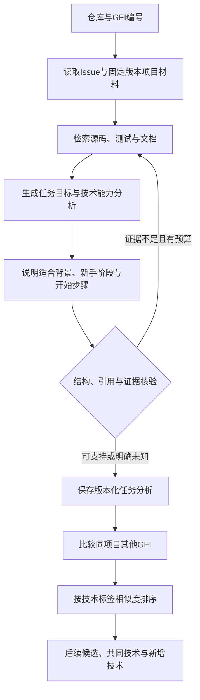

# 项目与GFI分析及后续贡献任务建议

> **2026-10-19代码整理：** 当前模块与职责见 [代码结构](CODE_STRUCTURE.md)，旧Streamlit界面已退役。下文早期设计不作为当前文件清单。

> **2026-10-18研究工作流更新：** A/B/C/D研究执行已迁移至LangGraph StateGraph＋LangChain ChatDeepSeek，含分析、核查、门控、补检与输出节点。当前实现以 [LangGraph工作流](LANGGRAPH_WORKFLOW.md) 为准；下文“计划加入LangGraph”等内容保留为早期设计记录。已报告156份答案仍来自原Python编排版本。

> 最新产品入口为HTML新人门户，已接入967条DeepSeek中文说明与50条DeepSeek源码级v2分析，具体覆盖和运行方式见[新人门户说明](NEWCOMER_PORTAL.md)。本文后续部分保留早期阶段记录。

范围纠正：2026-10-16。输入为仓库和GFI，输出为任务分析、适合背景/新手阶段及同项目后续任务建议。不建立个人画像，不追踪个人能力或进行用户匹配。

当前Demo简化：所有已采集GFI统一视为开放、未解决，关闭/指派/认领/PR不作过滤，也不补查实时状态。原始记录保持采集事实；演示状态作为独立覆盖层。A→B只按任务需求技术栈匹配，不验证个人能力或难度进阶。

## 1. 当前实现与规划边界

已有五项目967条原始Issue，清洗为159条开放具体任务、786条关闭具体任务和22条指引/汇总。已有50条助手分析草稿、一次Manim #4983的DeepSeek Flash真实分析；均不是独立评测标准答案。模拟画像与用户匹配支线已移除。

实际原型使用langchain-core、langchain-deepseek、Pydantic及SQLite FTS5，实现固定单任务检索与分析；另用标准库规则归一化50条已有草稿的技术标签，已生成同项目技术匹配。schema v2（技术栈/适合背景/新手阶段/开始步骤）、统一适配器、批量分析与三级缓存、Streamlit页面已实现；自主补查仍未实现，状态刷新按Demo需求不启用。数据实查见data/DATA_AUDIT.md，Demo见docs/DEMO_MATCHING_GUIDE.md。

## 2. 技术框架

| 层次 | 当前或计划技术 | 职责 |
| --- | --- | --- |
| 采集 | 已有Python标准库、GitHub REST API | Issue、评论、timeline、固定commit源码；Demo使用本地数据，不补查状态/PR |
| 清洗 | 已有clean_gfi.py | 保留原文，区分开放具体任务、历史任务与汇总指引 |
| 任务开发样本 | 已有prepare_annotation_drafts.py | 导出助手草稿与原始技能证据，保留独立复核表 |
| 检索 | 已有SQLite FTS5；计划精确路径/符号检索 | 定位代码、测试、贡献指南与依赖说明 |
| 模型 | 已有LangChain LCEL、DeepSeek Flash、Pydantic | 基于证据输出结构化分析与未知项 |
| 流程控制 | 计划需要时加入LangGraph | 管理有限补查与失败终止，初版最多补查两轮 |
| 任务匹配 | 已有标准库规则归一化与加权Jaccard | 仅同项目比较需求技术标签，输出共同技术和新增技术 |
| 展示 | 计划Streamlit | 项目/GFI输入、分析报告、证据及后续候选 |
| 评估 | 计划Python与独立人工评审 | 对照实验、证据支持、阶段判断及衔接合理性 |

暂不引入向量数据库、微调、多智能体、独立FastAPI服务或长期个人信息库。需要时根据验证结果增加。

## 3. 分析流程

图为目标流程；旧版单任务模型分析保持原样，新版v2模型字段经统一适配器接入草稿技术标签匹配，并带缓存与离线页面。是否真正支持语义结论仍需人工检查，不把路径存在当作结论正确。

## 4. 目标输出

| 输出部分 | 内容及约束 |
| --- | --- |
| 任务目标 | 当前行为、期望行为、修改边界 |
| 技术栈 | 语言/库/测试与构建工具，区分项目依赖和本任务实际需要 |
| 能力要求 | 知识、操作和原始证据，区分明确要求与推断 |
| 适合背景 | 描述哪种开发经历有帮助、需要先补哪些内容，不匹配具体个人 |
| 新手阶段 | 基础入门/具备开发基础/已有一定项目经验，给进入条件、判断依据；证据不足时未知 |
| 开始步骤 | 阅读、环境准备、最小复现及验证建议，不伪造执行结果 |
| 演示状态与风险 | 显式记录demo_assumption，统一开放/未解决；原始状态和分析未知项保留，不作过滤 |

旧analysis.json保持旧schema不改写。schema v2已实现于analysis_v2.py，缓存绑定Issue内容哈希、源码SHA、模型、提示词/schema和检索版本；技术标签缓存另绑分析结果与规则哈希，匹配缓存绑A/B技术描述、规则版本与K值。原始材料均视为数据，不作为执行指令。

## 5. 同项目后续GFI建议

以A的需求技术标签匹配同项目其他具体任务B，不声称贡献者已经掌握全部相关技能。所有记录演示状态为开放/未解决，关闭、指派和PR均不参与过滤。

1. 从50条现有助手任务草稿的技能名称/理由提取技术标签，保留原要求和证据；尚未分析的895个具体任务不补造标签。
2. 权重为通用技术1、知识概念2、专用技术3。按共同标签权重/并集标签权重的加权Jaccard排序，平局按专业共同标签数量、任务ID固定。
3. 输出最多3个同项目、非自身、具体任务候选，列出共同技术、新增技术和A/B双侧证据。无交集时不强行推荐。
4. 只有Python/测试等通用标签重合时明确标记generic_only；数值是技术相似度，不是成功率。

加权Jaccard本身是对称的；A→B展示的“新增技术”有方向性，但不代表经过验证的学习进阶。这是本轮Demo明确采用的简化。

## 6. 数据保留与补充

保留原始Issue、评论、timeline、固定版本源码、清洗记录、助手任务草稿、任务复核表和真实模型运行。闭合历史任务可用于分析案例，不能当作成功解决标签。

本轮Demo不补当前状态与PR，related_pull_requests为空也不阻塞匹配。已有50条草稿足以演示，按需要扩展其余任务的技术分析即可。项目README、贡献指南、依赖、测试与CI已经在源码里，可后续抽取项目上下文。独立人工复核和留出测试集在后续科研验证时补充。

仅当做历史解决过程或历史回放评估时，再采集选定解决PR的diff、review、测试及修复前版本。当前源码是采集时快照，不能直接用于无泄露的历史回放。不需要全贡献者历史、全部Git分支、个人画像或立即扩张仓库数量。

## 7. 评估

| 研究问题 | 对照 | 观察指标 |
| --- | --- | --- |
| 项目证据是否改善任务理解 | 仅Issue；Issue+项目证据 | 技能/代码定位准确性、证据支持、未知项处理 |
| 阶段说明是否合理 | 统一口径下的独立评审 | 阶段一致性、进入条件充分性、过度简化情况 |
| 任务关联是否改善衔接 | 随机候选/同模块候选；有证据的任务联系 | 知识复用、新增负担、衔接合理性、状态有效性 |
| 工程表现 | 同模型、输入和预算有记录 | 调用数、tokens、耗时、失败率与缓存效果 |

50条助手草稿只是开发样本；新增未用于调规则的任务作为留出集，至少部分样本双人独立复核。不能用助手自己的输出评价正确率，也不能宣称已证明新人留存或真实贡献提升。

## 8. 后续执行顺序

1. 已完成：保留原始状态，生成全部GFI开放/未解决的独立Demo视图。
2. 已完成：50条已有任务分析归一化技术标签，按A→B输出同项目匹配与依据。
3. 按需推进：schema v2的模型技术栈、适合背景、新手阶段、开始步骤及演示界面，不以补查状态/PR为前置任务。
4. 研究阶段再冻结评测任务与规则，开展独立对照评估。

每一阶段完成后暂停汇报，不自动启动下一阶段或消耗模型预算。
