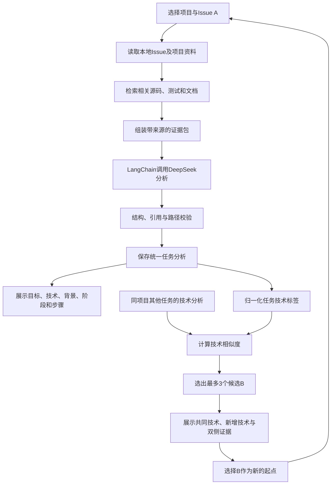

# GFI分析与同项目任务推荐：功能目标及技术路线

整理日期：2026-10-16。

本文总结当前项目希望实现的功能、输入输出和技术路线，可用于团队分工、项目介绍及参赛汇报。具体实现细节见[完整技术文档](docs/PROJECT_TECHNICAL_DOCUMENT.md)，实际分析覆盖和运行结果以代码及运行清单为准。

## 1. 项目定位

本项目希望构建一个面向开源新手的Good First Issue（GFI）分析智能体。

用户选择一个开源项目和其中的Issue A，系统结合Issue描述、讨论、项目代码、测试及文档，解释任务目标、技术需求、适合背景、新手阶段和开始步骤，再根据技术需求匹配同一项目中的其他Issue B。

项目希望帮助使用者依次回答三个问题：

1. 这个GFI到底需要做什么，应从哪里开始？
2. 它需要哪些技术，适合什么背景、什么阶段的新手？
3. 研究或完成这个GFI后，同项目还有哪些技术相关的任务可以继续尝试？

这里的“适合什么人”是对任务进入条件的说明，例如“掌握Python类与继承、能够阅读基础单元测试的新手”，不需要建立具体个人的技能画像。

## 2. 当前Demo约定

| 事项 | 采用的规则 |
| --- | --- |
| GFI状态 | 演示中统一按开放、未解决处理 |
| 关闭、指派、认领与PR | 保留采集事实，不用于筛选推荐 |
| 原始数据 | 保留原始状态，演示状态单独标记 |
| 推荐范围 | 同一项目内的其他具体任务 |
| 推荐依据 | 任务A与任务B需要的技术栈和知识标签 |
| 推荐数量 | 默认最多3项，允许没有或不足3项 |
| 用户信息 | 不建立个人画像，不采集个人能力数据 |
| 结果含义 | 描述任务与技术联系，不给出个人成功率 |

统一假设开放和未解决，是为了使Demo集中展示任务分析与技术匹配。它不表示现实GitHub状态已经核验。

## 3. 希望实现的主要功能

| 功能 | 具体内容 | 交付给使用者的结果 |
| --- | --- | --- |
| 项目与GFI选择 | 选择项目、输入或选择Issue编号 | 明确本次分析对象 |
| 项目背景说明 | 理解项目用途、主要模块和开发环境 | 简洁的项目概览 |
| GFI需求分析 | 提炼问题、预期行为和修改范围 | “要做什么”的任务说明 |
| 相关代码定位 | 检索相关文件、类、函数、测试和文档 | 可追溯的代码阅读入口 |
| 技术栈分析 | 识别完成该任务涉及的语言、库、框架和工具 | 技术清单及各项用途 |
| 知识要求分析 | 解释任务涉及的概念与必要操作 | 需要具备或补充的知识 |
| 适合背景说明 | 描述有助于开始任务的开发经历 | 面向某类新手的进入条件 |
| 新手阶段判断 | 根据代码范围、知识要求和验证难度说明阶段 | 基础入门、具备开发基础、已有项目经验或信息不足 |
| 开始步骤建议 | 提供阅读、环境准备、复现和验证顺序 | 可以照着执行的入手清单 |
| 验收建议 | 给出可检查的预期行为和测试方向 | 待确认的完成条件 |
| 同项目GFI匹配 | 比较A和B需要的技术 | 技术相关的后续任务候选 |
| 推荐解释 | 展示共同技术、新增技术和双方依据 | 明白为什么出现这个B |
| 连续任务探索 | 将候选B作为新的起点 | 继续浏览B的分析与相关任务 |
| 证据展示 | 展开Issue、代码和测试引用 | 判断依据可以核查 |

阶段判断必须给出理由，不能只依据GFI标签或修改行数。证据不足时保留未知项。

## 4. 输入数据与使用方式

### 4.1 使用者的直接输入

| 输入 | 示例 | 用途 |
| --- | --- | --- |
| 项目标识 | `ray-project/ray` | 选择源码和任务集合 |
| Issue A编号 | `38061` | 指定当前需要分析的任务 |
| 候选数量，可选 | `3` | 控制最多展示的后续任务数量 |

使用者不需要手动填写技术标签；标签应从任务分析中产生。

### 4.2 系统需要的基础资料

| 数据 | 主要用途 |
| --- | --- |
| 仓库基本信息、README | 理解项目背景和主要用途 |
| Issue标题和正文 | 理解问题、需求、复现及技术线索 |
| 相关评论 | 补充设计讨论、限制和上下文 |
| 固定版本源码 | 定位真实实现，解释修改范围 |
| 测试文件 | 理解行为边界和验证方式 |
| 贡献指南与依赖配置 | 提供开始步骤和环境说明 |
| 同项目其他GFI | 形成后续候选池 |
| 任务分析及技术标签 | 支撑A与B的比较 |
| 证据链接、行号、源码版本 | 支持结论追溯和复现 |

项目依赖与任务需求分别处理。例如，一个项目使用Qt，不代表其中每一个GFI都需要Qt。

### 4.3 当前数据基础

当前已整理SymPy、napari、Dask、Manim和Ray五个项目，原始记录共967条，清洗后有945个具体任务和22条指引/汇总记录，并保存50条助手任务分析草稿。

助手草稿、真实模型输出和规则匹配结果具有不同来源，不能混称为模型已经分析了全部任务。新生成模型分析和推荐的实际覆盖范围，以各运行清单为准。

## 5. 总体技术路线

目标流程由“任务分析”和“技术匹配”两部分组成。任务分析结果可以预先生成并缓存，使用者查看和切换任务时优先复用。



图中展示目标业务流程。数据、旧草稿、新版模型分析和界面的实际接入应通过统一适配器与来源字段区分，不能仅将旧文件改名视为完成自动化。

## 6. 技术选型

| 层次 | 技术 | 主要职责 |
| --- | --- | --- |
| 数据采集 | Python、GitHub REST API | 获取Issue、评论、时间线和固定源码 |
| 数据整理 | Python | 去重、统一格式、区分具体任务与汇总/指引 |
| 文件存储 | JSON、JSONL、CSV | 保存原始材料、分析、证据与人工复核信息 |
| 代码检索 | SQLite FTS5 | 根据任务线索召回代码、测试及文档 |
| 模型编排 | LangChain | 组织提示词、模型调用及结果校验流程 |
| 语言模型 | DeepSeek Flash | 理解证据，生成结构化任务分析 |
| 输出校验 | Pydantic、Python | 约束字段、枚举、引用和文件路径 |
| 技术归一化 | 透明规则与统一标签 | 合并不同表述，保留原始要求与证据 |
| 任务排序 | 加权Jaccard相似度 | 计算任务间技术重合程度 |
| 缓存 | 本地分析、标签和匹配缓存 | 减少重复分析和模型请求 |
| 交互展示 | Streamlit | 展示分析、证据、候选和任务切换 |
| 工程验证 | unittest、输入与源码哈希 | 检查程序行为和产物可复现性 |

当前路线以本地文件和轻量工作流为基础。证据不足时的自主补查可后续增加，LangGraph属于需要有限循环时的可选工具，不是当前Demo的必选依赖。

## 7. 关键处理过程

### 7.1 数据准备

以项目为单位保存Issue和固定版本源码。清洗过程保留原始内容与状态，并识别指引、汇总和具体任务。

Demo生成独立的开放/未解决视图，避免为了演示修改原始材料。关闭的具体任务只要已有技术分析，同样可以参与匹配。

### 7.2 证据检索

从Issue中提取类名、函数名、路径、错误消息和技术词，检索相关源码、测试及文档，组成有限大小的证据包。

每条证据保存来源。源码证据绑定commit、文件路径和行号，避免向模型一次性发送整个仓库。

### 7.3 任务分析

模型根据证据生成任务目标、技术栈、知识要求、相关文件、适合背景、新手阶段、开始步骤、验收建议和未知项。

结论区分明确要求与合理推断；引用应能回到原始材料。字段校验和引用存在性检查不能代替结论的语义审核。

### 7.4 标签归一化

将“NumPy索引”“ndarray切片”等不同描述映射到统一的技术或知识标签，保留原始要求及其引用。

标签涵盖语言、库、框架、工具和知识概念。通用技术的权重较低，任务相关的专用技术和概念更有区分度。

### 7.5 同项目技术匹配

设任务A和B的技术标签集合分别为`T_A`、`T_B`，标签权重为`w(t)`：

```text
相似度 = 共同标签的权重之和 / 两个任务标签并集的权重之和

共同技术 = T_A ∩ T_B
新增技术 = T_B - T_A
```

当前规则采用1、2、3三级权重，分别用于较通用技术、知识概念以及专用技术等，具体值由规则文件声明。

匹配时排除跨项目、自身、非具体任务及无交集候选，按相似度排序。同分时采用固定规则保证结果稳定。仅有通用标签重合时注明弱匹配。

相似度反映标签重合，不是成功概率。相似度本身对称，而“A到B需要新增什么技术”具有方向性；这种方向性尚不构成经过验证的难度进阶。

### 7.6 展示与继续探索

页面同时呈现当前任务分析和后续候选。候选卡片说明“为什么相关”和“还需要了解什么”，并支持展开证据、切换起点。

已经生成的分析优先使用缓存，避免每次点击重新调用模型。没有分析时明确显示待分析；没有候选时允许空结果。

## 8. 预期输出

| 输出部分 | 内容 |
| --- | --- |
| 项目概览 | 项目用途、主要模块、基础开发环境 |
| GFI概览 | 标题、任务目标、问题与修改范围 |
| 技术要求 | 技术栈、知识点、在任务中的作用 |
| 适合背景 | 有帮助的开发经历和前置知识 |
| 新手阶段 | 阶段建议、进入条件及依据 |
| 入手清单 | 阅读顺序、环境准备、复现和验证建议 |
| 证据清单 | Issue、评论、固定版本代码及测试引用 |
| 后续候选 | 同项目B任务、相似度、共同技术和新增技术 |
| 运行说明 | 数据版本、来源、演示假设和未知项 |

## 9. 实施与完善顺序

1. 准备统一项目数据，保证Issue、源码、分类和证据能够对应。
2. 完善任务分析字段，形成可复用的统一分析结果。
3. 将真实模型结果和已有草稿通过来源明确的适配器接入技术匹配。
4. 扩展有代表性的任务覆盖，并检查典型技术标签和推荐解释。
5. 完成交互页面，使“选择A—理解A—查看B—继续探索”形成完整操作流程。
6. 按需要开展小规模对照评估，比较仅Issue与加入项目证据的分析，以及不同匹配规则。

仓库里已存在新版分析、批量处理、缓存和页面相关代码；源码存在不等于所有数据都经过真实调用或完整验收，具体可用范围需以实际运行和检查结果说明。

## 10. 展示时应强调的价值

- 把简短的GFI描述转化为有代码和测试依据的任务导读。
- 从“项目整体用了什么”进一步说明“完成这个任务需要什么”。
- 通过适合背景、阶段条件和开始步骤，降低新手理解任务的成本。
- 用共同技术和新增技术解释同项目后续候选，便于连续探索。
- 保存分析来源、证据和数据版本，使结果能够检查与复现。

项目展示重点是完整的任务理解与技术匹配流程。当前Demo不主张已经证明用户留存、贡献成功率或长期成长效果。
