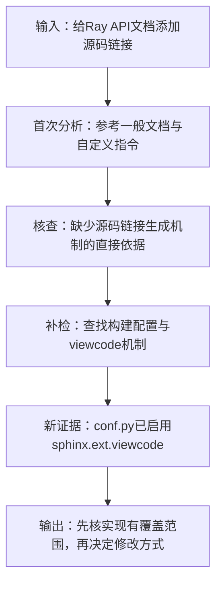

# Agent真实运行案例：Ray #3269

整理日期：2026年10月19日。

本文只使用旧版已经保存的生成、核查与检索记录，不读取外部评审分数，不重新调用模型，不修改实验数据。用途是说明Agent怎样工作，不是证明D组获胜。

## 一、一句话讲清这个案例

**用户希望在API文档中增加源码链接。Agent起初只找到一般文档和自定义指令代码；核查发现实现依据不足，补检后定位到已启用的源码链接扩展，于是将入手建议具体化为“先检查现有机制及其覆盖范围”。**

## 二、可直接放入PPT的一页

### 标题

**真实案例：从“添加源码链接”到“核实已有实现”**

### 左上角：任务输入

> Ray #3269：希望Ray文档像Keras文档一样，为API提供可跳转到对应源码的“source”链接。

### 主体：五个步骤

| 步骤 | 本案例真实发生了什么 |
| --- | --- |
| ① 首次分析 | 根据Issue和初始证据，将任务解释为文档源码链接功能；建议阅读 `custom_directives.py`，判断生成链接的位置 |
| ② 证据核查 | 发现现有证据未展示源码链接的实际生成机制；“与自定义指令保持一致、避免手工维护”缺乏充分依据 |
| ③ 按缺口补检 | 发起与文档构建、源码链接、`autodoc`、`viewcode`相关的查询，新增4个证据片段 |
| ④ 更新分析 | 在 `conf.py` 找到已注册的 `sphinx.ext.viewcode`，并定位到API生成钩子及构建警告配置 |
| ⑤ 输出建议 | 先检查既有扩展是否覆盖目标API，再决定是否修改；将构建和链接检查标为推断出的建议验证项，保留覆盖范围未知 |

### 页面重点框

> **证据核查没有直接认定“需要从零实现”；补检使建议从泛泛的扩展开发，转向核实现有机制。**

### 页脚小字

> D组真实运行记录：2轮、4次逻辑模型调用，新增4个证据片段。仅分析固定快照，未实际构建文档、修改代码或验证生成链接，不代表外部评审已确认效果。

### 配图：简版竖向流程



### 约40秒讲解稿

> 这道任务希望给Ray文档增加源码链接。Agent第一次找到了文档贡献说明和自定义指令代码，因此建议先看自定义指令。但核查发现，这些材料还不能说明源码链接究竟怎么生成。系统据此补检，在Sphinx配置中发现viewcode其实已经启用。第二次分析就把建议具体化为：先核实现有扩展覆盖了哪些API，再决定如何修改。系统仍保留覆盖范围未知，也没有声称链接已经验证成功。这里展示的是证据怎样改变入手建议，而不是只展示一次模型回答。

---

## 三、案例选择与数据范围

| 项目 | 内容 |
| --- | --- |
| Issue | `ray-project/ray#3269` |
| 原始标题 | `[doc] Provide source links to documentation` |
| Issue地址 | https://github.com/ray-project/ray/issues/3269 |
| 分析条件 | D：缺口驱动自适应补检 |
| 仓库固定快照 | `3235a8e1e84de7c7fde217553c83e3c38d8560fe` |
| 模型 | `deepseek-flash` |
| 记录来源 | `experiments/frozen_20261017/equal_calls_v1/results/ray-project__ray__3269/D.json` |

为了使一页PPT能讲完整流程，从已完成的34题中挑选“两轮、有一次补检”的任务，再按冻结任务ID顺序取第一项。本案例是事后选取的流程说明，不是预先指定的独立验证案例；没有按评审分数选取。

所有解释针对固定仓库快照。该快照未必对应Issue提出时的历史代码状态，不能将此案例表述成“还原当年修复过程”。

## 四、输入具体是什么？

### Issue要求：中文转述

Keras的方法文档带有“source”链接，希望Ray文档也提供类似功能。原Issue给出一个Keras页面作为参考。

**Issue没有明确指定：**

- 哪些API、模块和页面需要覆盖。
- 必须采用哪个Sphinx扩展或自定义机制。
- 当前代码已经覆盖了多少。
- 具体测试要求或维护者偏好的实现方式。

### 首轮证据

输入包含Issue正文I1，以及8个源码或文档片段，部分与任务关系较弱。以下为关键部分：

| 证据ID | 位置（固定快照） | 作用与限制 |
| --- | --- | --- |
| I1 | Issue正文 | 支持“为Ray文档增加源码链接”的任务目标 |
| E5 | `doc/source/ray-contribute/publishing-examples.md`，61—73行 | 提供文档本地构建说明，不直接证明源码链接如何生成 |
| E6 | `doc/source/custom_directives.py`，841—920行 | 显示已有Sphinx自定义扩展代码，但未展示源码链接生成机制 |
| E7 | `doc/source/custom_directives.py`，1141—1220行 | 同上，不能仅因文件相关就认定方案应在这里实现 |

首轮还检索到Keras相关示例和一个图像工具测试片段；它们不等于本任务的直接实现或测试证据。检索到材料，并不意味着已经找到充分依据。

## 五、第一轮分析、核查与门控

### 首次分析：原文摘录

> “为 Ray 文档中的 API/方法页面提供类似 Keras 文档的‘source’源码链接，使读者能从文档跳转到对应源码。”

首轮入手建议包含阅读 `custom_directives.py`，了解现有自定义指令与渲染机制，并判断源码链接生成位置。

### 核查发现两个问题

| 结论编号（第1轮） | 原结论概述 | 核查结果 | 门控处理 |
| --- | --- | --- | --- |
| `acceptance:1` | 建议构建文档无错误，并检查新增源码链接跳转 | `partial`：已有材料不足以充分支持这组验证建议 | 从本轮门控后的验收项中暂缓输出 |
| `acceptance:2` | 与现有自定义指令机制一致，避免逐页手工维护 | `partial`：未找到源码链接相关的实际机制，Issue也没有要求避免手工维护 | 从本轮门控后的验收项中暂缓输出 |

第一轮原始答案有3条验收项；门控后保留1条，暂缓2条。这里的“暂缓”不是删除原始记录：原始结论、核查理由仍保存在结果中。

**需要客观说明：**“构建和点击检查”本身可能是合理的软件工程建议。首轮核查对这些建议的依据要求偏保守，这同样是模型核查的局限，不能把每一次拦截都当作正确判断。

## 六、系统具体查了什么？

第一轮核查生成的查询为：

```text
build-ray-docs sphinx-build -W doc/source
custom_directives.py source link directive autodoc viewcode
```

这些字符串是提交给固定源码快照检索器的查询，不是实际执行的Shell命令；系统没有执行 `sphinx-build`。

新增片段：

| 证据ID | 位置 | 关键发现 |
| --- | --- | --- |
| E9 | `.readthedocs.yaml`，121—142行 | 第136行有 `fail_on_warning: true` |
| E10 | `.readthedocs.yaml`，61—140行 | 补充文档构建配置，与E9部分重叠 |
| E11 | `doc/source/conf.py`，721—800行 | 第778行连接 `_autogen_apis`，第780行连接 `autodoc-process-signature` |
| E12 | `doc/source/conf.py`，61—140行 | 已注册 `sphinx.ext.autodoc`、`sphinx.ext.viewcode`、`sphinx.ext.autosummary` |

本次增加的是4个**证据片段**，来自2个不同文件，不是4个新文件。

### 可以放在PPT角落的两条代码证据

来自E12，`conf.py`第66行：

```python
    "sphinx.ext.viewcode",
```

来自E9，`.readthedocs.yaml`第136行：

```yaml
  fail_on_warning: true
```

这些片段能说明配置中已启用相关机制；它们不能单独证明所有API页面都有正确的源码链接。

## 七、第二轮发生了哪些变化？

| 内容 | 第1轮 | 第2轮 |
| --- | --- | --- |
| 源码链接机制 | 只看到一般文档和自定义指令，具体机制未知 | 明确定位已启用的 `viewcode` 与 `autodoc/autosummary` |
| 开始阅读的位置 | 主要建议阅读 `custom_directives.py` | 优先阅读 `conf.py`中的扩展注册和API生成钩子 |
| 构建验证依据 | 主要引用一般文档贡献说明 | 直接引用Read the Docs的 `fail_on_warning` 配置 |
| 验收建议 | 包含“避免逐页手工维护”的宽泛建议 | 不再输出这一条，改为根据配置检查构建警告及链接位置 |
| 门控后验收项 | 1条 | 3条，其中2条明确标记为推断／建议 |

不能把两轮的 `acceptance:1`、`acceptance:2` 当作完全相同的固定结论：模型重新组织了验收项，旧编号在下一轮可能对应改写后的内容。因此这里比较的是内容变化，不声称“原来的同一句话被补检直接证实”。

第二轮核查接受了全部当前结论（包括允许的合理推断），`withheld_claim_ids`为空；停止原因是 `all_claims_supported`。这表示**内部核查认为当前结论得到支持**，不是独立评委已经给出高分，也不是任务已经实现。

## 八、给新人的最终信息：展示用中文归纳

> **要做什么：**让Ray API文档能够跳转到对应源码。
>
> **先从哪里看：**先读 `doc/source/conf.py`，核实已启用的 `sphinx.ext.viewcode` 和API文档生成配置；不要一开始就假设需要从零新增链接生成器。
>
> **再检查什么：**确认现有机制覆盖哪些API，查清哪些页面仍然缺失；了解文档构建的警告检查规则。
>
> **建议怎样验证：**本地构建后检查目标页面是否出现正确的源码链接、是否引入新的警告。这是建议验证方式，本次Agent没有实际执行。
>
> **仍然不知道：**Issue未指定完整覆盖范围，现有扩展实际覆盖程度和剩余工作量未核实，维护者的实现偏好及实时任务状态未知。

以上为人工整理的展示文案，不是修改后的实验输出，也不回写原始答案。

## 九、调用记录及案例边界

| 项目 | 旧版D结果记录 |
| --- | ---: |
| 完整分析轮数 | 2 |
| 逻辑模型调用次数 | 4（分析2次＋核查2次） |
| 输入Token | 34,449 |
| 输出Token | 4,530 |
| 合计Token | 38,979 |
| 新增证据片段 | 4 |
| 最终暂缓结论 | 0 |

Token数仅为该D答案保存的资源记录，不包含R/S的成本、其他题成本或外部评审成本；公共初轮归属规则仍与原实验一致。

### 能说明

- 系统确实执行了“分析—核查—门控—补检—重分析”的闭环。
- 补检结果包含能够具体改变入手位置与验证建议的配置证据。
- 已有机制、推断建议和仍未知的范围能够分别表达。

### 不能说明

- 不能单凭这一例证明D优于R/S，必须结合正在进行的配对评审。
- 没有真实修复、PR、文档构建或页面跳转验证，不能宣称任务已经完成。
- 内部核查与分析来自同一模型体系，不等于独立人工核验。
- 引用校验检查结构与引用合法性，不保证结论语义全部正确。
- 固定快照可能包含Issue之后的代码，不据此声称历史修复定位能力。

## 十、原始记录与追溯位置

- 主记录：`experiments/frozen_20261017/equal_calls_v1/results/ray-project__ray__3269/D.json`。
- `rounds[0].packet`：首次输入与初始证据。
- `rounds[0].analysis`：首次分析。
- `rounds[0].audit.reviews`：逐条核查理由。
- `rounds[0].gated`：首次门控后的输出。
- `rounds[0].retrieval`：两条查询和新增E9—E12。
- `rounds[1].packet`：补检后的完整证据包。
- `rounds[1].analysis`及`rounds[1].gated`：第二次分析及最终输出。
- `resources`：调用次数与Token记录。

证据位置均基于上述固定提交：

- [E12：Sphinx扩展配置](https://github.com/ray-project/ray/blob/3235a8e1e84de7c7fde217553c83e3c38d8560fe/doc/source/conf.py#L61-L140)
- [E11：API生成钩子](https://github.com/ray-project/ray/blob/3235a8e1e84de7c7fde217553c83e3c38d8560fe/doc/source/conf.py#L721-L800)
- [E9：文档构建警告配置](https://github.com/ray-project/ray/blob/3235a8e1e84de7c7fde217553c83e3c38d8560fe/.readthedocs.yaml#L121-L142)

本文未访问在线页面；链接由已保存证据中的固定提交URL核对生成。
